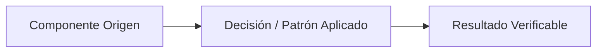

# ADR-XXXX: [Título corto de la decisión]

* **Fecha:** YYYY-MM-DD
* **Estado:** Aceptado

## Contexto y Problema

[Descripción clara y concisa del requerimiento funcional, atributo de calidad, restricción del dominio o desafío técnico que motiva la necesidad de tomar esta decisión arquitectónica. Explicar qué fuerzas entran en tensión y qué riesgo se busca mitigar.]

## Decisión y Justificación

[Declaración directa de la solución arquitectónica, patrón de diseño o restricción física adoptada, seguida de los fundamentos técnicos que respaldan la elección.]

### Alternativas Descartadas

* **[Alternativa 1]:** [Descripción breve de la opción evaluada y el motivo técnico o de negocio concreto por el cual fue rechazada.]
* **[Alternativa 2]:** [Descripción breve de la segunda opción evaluada y el motivo técnico o de negocio concreto por el cual fue rechazada.]

## Flujo Visual (Opcional)

## Compensaciones y Consecuencias

* **Ganancias / Beneficios:**
  * [Beneficio técnico, de mantenibilidad, integridad o seguridad obtenido con la decisión.]
  * [Segundo beneficio directo y verificable en el sistema.]
* **Costos / Deuda Técnica:**
  * [Complejidad adicional, sobrecarga operativa, restricción aceptada o riesgo residual asumido conscientemente.]
  * [Mecanismo de mitigación previsto o condición bajo la cual debería revisarse esta decisión.]
