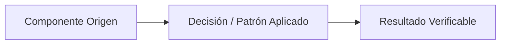

# ADR-XXXX: [Título corto de la decisión]

* **Fecha de propuesta:** YYYY-MM-DD
* **Fecha de aceptación:** YYYY-MM-DD (alcanzado el acuerdo explícito del equipo)
* **Estado:** Propuesto

> **Nota metodológica:** Una decisión en estado `Aceptado` formaliza la elección técnica consensuada por el equipo, pero no acredita la implementación de código ni la existencia de servicios en el repositorio hasta su ejecución y verificación en las tareas de ingeniería correspondientes. Durante la revisión del Pull Request introductorio aún abierto, revisiones y correcciones conservan el mismo ID; tras integrarse en la rama principal, cambios sustantivos requieren un nuevo ADR sucesor (`Superado por ADR-YYYY`).
## Contexto y Problema

[Descripción clara y concisa del requerimiento funcional, atributo de calidad, restricción del dominio o desafío técnico que motiva la necesidad de tomar esta decisión arquitectónica. Explicar qué fuerzas entran en tensión y qué riesgo se busca mitigar.]

## Decisión y Justificación

[Declaración directa de la solución arquitectónica, patrón de diseño o restricción física adoptada, seguida de los fundamentos técnicos que respaldan la elección.]

### Alternativas Descartadas

* **[Alternativa 1]:** [Descripción de la opción real y viable considerada por el equipo y el motivo técnico o de negocio concreto por el cual fue rechazada, sin inventar alternativas ficticias.]
* **[Alternativa 2]:** [Descripción de la segunda opción real considerada y el motivo técnico concreto de descarte.]

## Flujo Visual (Opcional)

## Compensaciones y Consecuencias

* **Ganancias / Beneficios:**
  * [Beneficio técnico, de mantenibilidad, integridad o seguridad obtenido con la decisión.]
  * [Segundo beneficio directo y verificable en el sistema.]
* **Costos / Deuda Técnica:**
  * [Complejidad adicional, sobrecarga operativa, restricción aceptada o riesgo residual asumido conscientemente.]
  * [Mecanismo de mitigación previsto.]
* **Condición de Revisión:**
  * [Condición concreta, cambio de escala o requerimiento futuro bajo el cual esta decisión debe ser revisada o superada.]
