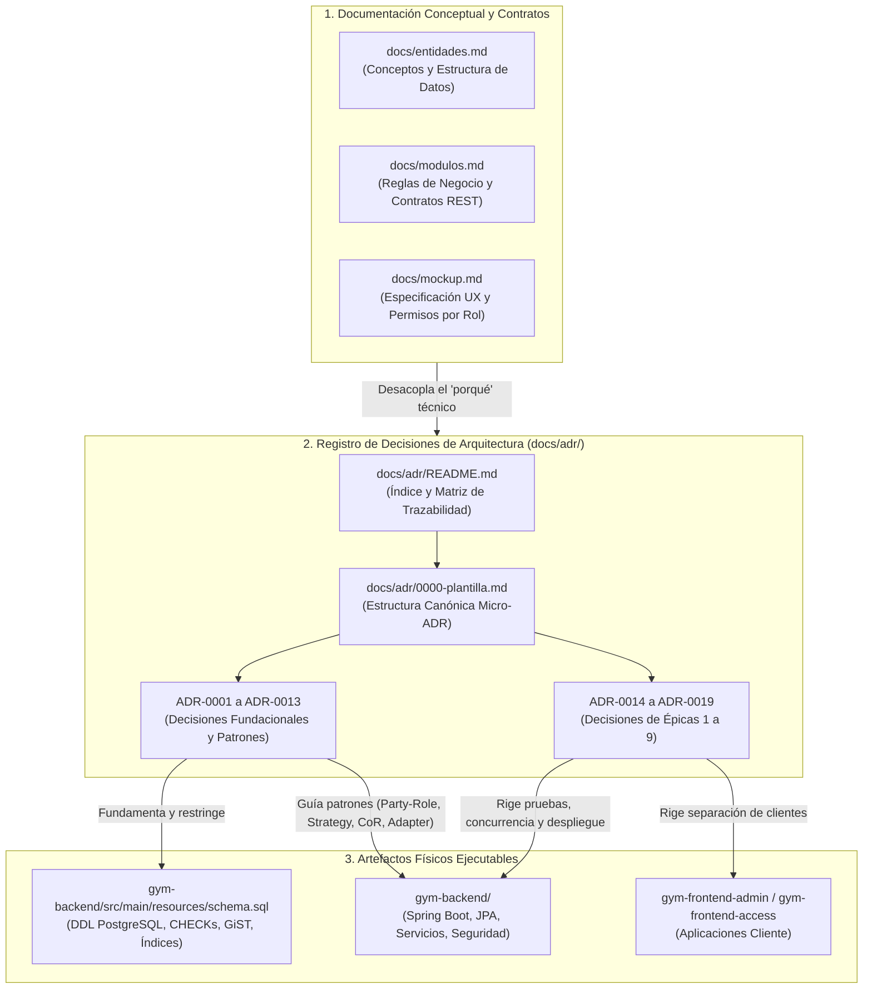

# ADR-0001: Registro de Decisiones de Arquitectura mediante Micro-ADRs

* **Fecha:** 2026-10-11
* **Estado:** Aceptado

## Contexto y Problema

Durante el diseño inicial del sistema **Gym Manager**, las justificaciones sobre restricciones físicas del motor PostgreSQL (como índices GiST con `btree_gist`, tipos `TIMESTAMPTZ`, secuencias `SERIAL` frente a `AUTO_INCREMENT` y cláusulas `ON DELETE RESTRICT`), elecciones de patrones de diseño (Party-Role, Ledger, Strategy, Chain of Responsibility, Adapter) y topologías de despliegue se documentaron de forma entrelazada dentro de los artefactos del dominio (`docs/entidades.md`, `docs/modulos.md` y `docs/mockup.md`).

Esta mezcla entre el **qué** exige el negocio y el **cómo** se resuelve técnicamente infringe el principio de aislamiento conceptual del dominio (Heurísticas 7 y 20), dificultando la lectura de las reglas comerciales puras y acoplando el modelo conceptual a tecnologías o proveedores específicos. Al mismo tiempo, eliminar sin más dichas justificaciones durante el saneamiento documental (Épica 0) provocaría la pérdida de memoria arquitectónica del equipo, dejando sin respaldo el porqué de las invariantes declaradas en `gym-backend/src/main/resources/schema.sql` y en las capas de servicio.

Se requiere un mecanismo formal, liviano y versionado junto al código fuente que desacople las decisiones de arquitectura e implementación física respecto del modelo conceptual del dominio, garantizando trazabilidad bidireccional hacia las tareas de ingeniería y los requerimientos funcionales (RF-01 a RF-35).

## Decisión y Justificación

Se adopta el estándar de **Micro-ADRs (Architecture Decision Records)** redactados íntegramente en español técnico formal y alojados en el directorio `docs/adr/`, regidos por el índice maestro `docs/adr/README.md` y la plantilla canónica `docs/adr/0000-plantilla.md`.

La decisión se estructura sobre cuatro pilares normativos:

1. **Separación de Preocupaciones Documentales:**
   * `docs/entidades.md` y `docs/modulos.md` conservan exclusivamente las definiciones conceptuales del negocio, los contratos de interfaz REST y las especificaciones relacionales sin comparativas de motores ni justificaciones de infraestructura.
   * `docs/adr/ADR-XXXX-*.md` concentra el contexto técnico, los fundamentos de ingeniería, los patrones GoF/empresariales aplicados, las particularidades de PostgreSQL y los compromisos (*trade-offs*) asumidos.
2. **Ciclo de Vida y Política de Cambios:**
   * Toda decisión inicia en estado `Propuesto` en su plantilla y discusión; transiciona a `Aceptado` únicamente mediante acuerdo explícito del equipo. Una decisión aceptada formaliza la elección técnica consensuada, pero no acredita la implementación de código o servicios hasta su desarrollo y verificación efectiva en las tareas correspondientes.
   * Durante la revisión del Pull Request introductorio aún abierto, las revisiones, precisiones técnicas y erratas conservan su ID e historia Git. Tras su integración en `main`, las decisiones son inmutables en su intención histórica: cambios sustantivos requieren un ADR sucesor (`Superado por ADR-XXXX`), mientras que precisiones o erratas no sustantivas conservan el ID original.
3. **Evidencia Visual Estandarizada (`Flujo Visual`):**
   * Las decisiones que alteran la topología de clases o tablas, los límites entre capas o el flujo temporal de estados incorporan diagramas en sintaxis **Mermaid** (`flowchart`, `erDiagram`, `classDiagram` o `sequenceDiagram`) renderizables de forma nativa en el repositorio.
4. **Explicitación de Compromisos (`Compensaciones y Consecuencias`):**
   * Cada ADR declara alternativas reales y viables consideradas por el equipo bajo `### Alternativas Descartadas` (sin mínimos artificiales), y contrasta explícitamente las `* **Ganancias / Beneficios:**` frente a los `* **Costos / Deuda Técnica:**` y `* **Condición de Revisión:**`.

### Alternativas Descartadas

* **Documento monolítico de arquitectura (`docs/arquitectura.md`):** Se descartó porque un único archivo extenso tiende a desactualizarse rápidamente, genera conflictos de fusión (*merge conflicts*) cuando varios desarrolladores trabajan en paralelo sobre distintas épicas y dificulta referenciar decisiones puntuales e independientes desde las tareas del proyecto o desde los Pull Requests.
* **Wiki o herramienta externa no versionada en Git (Confluence / Notion):** Se descartó porque rompe la atomicidad entre el código fuente (`schema.sql`, backend, frontend) y la documentación arquitectónica. En un flujo de revisión por Pull Request, los cambios de diseño deben auditarse en el mismo *commit* e historial de ramas que el código que los materializa.
* **Mantener las justificaciones técnicas incrustadas en `docs/entidades.md` y `docs/modulos.md`:** Se descartó porque contamina las reglas de negocio con detalles de motores relacionales (`SERIAL` vs. `AUTO_INCREMENT`), tipos de lenguaje (`LocalDateTime`, `BigDecimal`) y proveedores de nube, incumpliendo las heurísticas académicas de separación entre el modelo conceptual del problema y la arquitectura de la solución.

## Flujo Visual

## Compensaciones y Consecuencias

* **Ganancias / Beneficios:**
  * **Pureza conceptual del dominio:** Permite sanear `docs/entidades.md`, `docs/modulos.md` y `docs/mockup.md` (Tareas 0.1 a 0.7) sin perder ninguna justificación técnica de diseño, reubicándolas en registros específicos y cohesionados.
  * **Trazabilidad auditable por tarea:** Cada tarea de ingeniería vincula explícitamente el ADR que debe respetar o el ADR a redactar que formaliza su diseño, facilitando la defensa académica y la revisión de código.
  * **Versionado atómico y revisión en Pull Requests:** Al residir en archivos Markdown individuales con diagramas Mermaid dentro del repositorio Git, cada decisión evoluciona bajo control de versiones sin depender de servicios externos.
* **Costos / Deuda Técnica:**
  * **Sobrecarga de mantenimiento documental:** Todo cambio arquitectónico relevante (como alterar la estrategia de bloqueo transaccional o el mecanismo de conciliación de pagos) exige redactar un nuevo ADR y actualizar la tabla de estados en `docs/adr/README.md`.
  * **Disciplina de sincronización:** Existe el riesgo de que el código evolucione sin reflejar la superación de un ADR previo; se mitiga incorporando la verificación de impacto en ADRs y contratos dentro de la lista de control de `.github/pull_request_template.md` (Tarea 0.8).
* **Condición de Revisión:**
  * Esta política de ADRs debe revisarse si el volumen documental dificulta el mantenimiento del repositorio o si el equipo adopta una herramienta automatizada de linters de arquitectura en CI.
