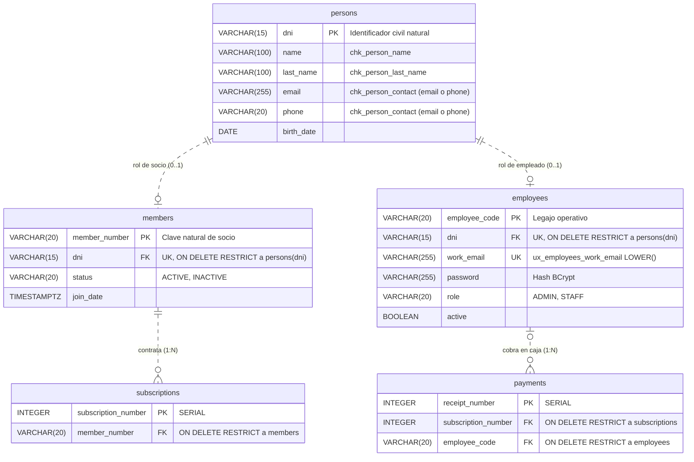

# ADR-0002: Modelado de Actores mediante Patrón Party-Role

* **Fecha:** 2026-10-11
* **Estado:** Aceptado

## Contexto y Problema

En la operatoria real de un gimnasio, un mismo individuo físico identificado legalmente por su Documento Nacional de Identidad (`dni`) puede desempeñar distintos papeles frente a la organización:

1. **Socio deportivo (`Member`):** Persona que contrata suscripciones (`subscriptions`) e ingresa a entrenar validando su membresía en la terminal de acceso (`access_logs`).
2. **Personal administrativo u operativo (`Employee`):** Persona que trabaja en el gimnasio con rol de administrador (`ADMIN`) o personal de mostrador/caja (`STAFF`), autenticándose en el sistema y registrando cobros (`payments`).
3. **Ambos roles en simultáneo o de forma sucesiva:** Es habitual que un profesor, recepcionista o encargado (`Employee`) también entrene en el gimnasio como socio (`Member`), o que un socio existente sea contratado posteriormente como parte del *staff* (y viceversa), sin dejar de ser la misma persona física.

Si se modela esta relación mediante herencia estática de clases u objetos (`Person <|-- Member` y `Person <|-- Employee`), el tipo de una instancia queda fijado en el momento de su creación. En consecuencia, que una empleada se inscriba como socia obligaría a duplicar sus datos personales (violando la unicidad del `dni`), a migrar destructivamente filas entre tablas o a introducir una clase combinada artificial (`MemberEmployee`). Además, los socios no poseen credenciales de acceso informático en el alcance del sistema, mientras que los empleados exigen correo laboral único (`work_email`), contraseña encriptada (`password`) y rol de seguridad (`role`).

## Decisión y Justificación

Se decide aplicar el patrón de análisis y diseño **Party-Role** (Martin Fowler / Heurística 9), separando la identidad civil de la persona respecto de los roles operativos que desempeña en la organización:

1. **Entidad base `Person` (`persons`):** Centraliza la identidad legal (`dni VARCHAR(15) PRIMARY KEY`) y los atributos civiles y de contacto (`name`, `last_name`, `email`, `phone`, `birth_date`), exigiendo al menos un canal de comunicación válido mediante `chk_person_contact CHECK (email IS NOT NULL OR phone IS NOT NULL)`.
2. **Rol `Member` (`members`):** Representa el vínculo deportivo mediante una asociación `1:1` opcional no identificadora hacia `persons`. Define su propia clave primaria de negocio (`member_number VARCHAR(20) PRIMARY KEY`) y referencia a la persona mediante `dni VARCHAR(15) UNIQUE NOT NULL REFERENCES persons(dni) ON DELETE RESTRICT`, almacenando únicamente `status` (`ACTIVE`, `INACTIVE`) y `join_date`.
3. **Rol `Employee` (`employees`):** Representa el vínculo laboral y de seguridad mediante una asociación `1:1` opcional no identificadora hacia `persons`. Define su clave primaria operativa (`employee_code VARCHAR(20) PRIMARY KEY`) y referencia a la persona mediante `dni VARCHAR(15) UNIQUE NOT NULL REFERENCES persons(dni) ON DELETE RESTRICT`, aislando de forma estricta las credenciales de autenticación (`work_email`, `password` con hash BCrypt, `role` en `ADMIN`/`STAFF` y estado `active`).
4. **Mapeo Objeto-Relacional (JPA/Hibernate) y Ciclo de Vida de Altas (RF-04, RF-08):**
   * En la capa de persistencia (Tareas 1.4 a 1.6), `Member` y `Employee` se vinculan a `Person` mediante `@OneToOne(fetch = FetchType.LAZY)` y `@JoinColumn(name = "dni", referencedColumnName = "dni", nullable = false, unique = true)`, **sin** propagación `CascadeType.REMOVE` para respetar `ON DELETE RESTRICT`.
   * En la capa de servicios (`MemberService` y `EmployeeService`, Tareas 2.2 y 2.4), al registrar un nuevo socio o empleado se busca primero si el `dni` ya existe en `persons`: si existe, se reutiliza la entidad `Person` existente y solo se instancia el nuevo rol; si no existe, se persiste primero `Person` y luego el rol correspondiente.

### Alternativas Descartadas

* **Herencia de entidades en JPA (`@Inheritance` con `SINGLE_TABLE`, `JOINED` o `TABLE_PER_CLASS`):** Se descartó porque la herencia en lenguajes orientados a objetos como Java y en mapeos ORM es estática y mutuamente excluyente: una instancia de `Employee` no puede ser simultáneamente instancia de `Member` bajo una misma fila de `persons`. Con `SINGLE_TABLE` se contaminaría una única tabla con columnas nulas cruzadas (`password` nulo para socios, `member_number` nulo para empleados) y un discriminador rígido incapaz de expresar ambos roles a la vez; con `JOINED`, asignar el segundo rol requeriría insertar manualmente en la tabla hija por fuera del ciclo de vida polimórfico de Hibernate.
* **Tablas `members` y `employees` independientes sin tabla `persons` compartida:** Se descartó porque duplicaría los atributos personales (`dni`, `name`, `last_name`, `email`, `phone`, `birth_date`) cuando una persona cumple ambos roles, provocando anomalías de actualización (cambiar el teléfono o apellido en una tabla dejaría desactualizada la otra) y perdiendo una fuente única de verdad para la identidad civil.
* **Tabla monolítica `users` con banderas booleanas (`is_member`, `is_employee`):** Se descartó porque acopla el dominio deportivo con la seguridad del sistema, expone campos de credenciales en las consultas del padrón de socios, debilita las restricciones `NOT NULL` específicas de cada rol (como `work_email`, `password` y `role`, que solo son obligatorios para empleados) y dificulta referenciar mediante claves foráneas estrictas quién cobró un pago (`payments.employee_code`) frente a quién contrató una suscripción (`subscriptions.member_number`).

## Flujo Visual

## Compensaciones y Consecuencias

* **Ganancias / Beneficios:**
  * **Flexibilidad dinámica de roles sin duplicación de identidad:** Una misma persona física (`persons.dni`) puede adquirir o desactivar independientemente el rol de socio (`members.status = 'INACTIVE'`) y el rol de empleado (`employees.active = FALSE`) en cualquier momento de su ciclo de vida, manteniendo un único registro civil y evitando errores `409 Conflict` al sumar un segundo rol.
  * **Aislamiento estricto de seguridad y credenciales:** Las credenciales de autenticación (`work_email`, `password`, `role`) residen exclusivamente en `employees`, garantizando que las operaciones sobre socios (`Member`) jamás manipulen ni expongan atributos de seguridad informática.
  * **Integridad referencial semántica:** Las tablas operativas referencian exactamente al rol que corresponde a la regla de negocio (`subscriptions` y `access_logs` apuntan a `members.member_number`, mientras que `payments` apunta a `employees.employee_code`), impidiendo a nivel de esquema que se asigne un cobro a un socio que no es empleado.
* **Costos / Deuda Técnica:**
  * **Necesidad de `JOIN` para consultas de ficha completa:** Obtener el listado o detalle de un socio o empleado junto con su nombre, apellido y contacto requiere un `JOIN` entre `members` (o `employees`) y `persons` por `dni`. Se mitiga indexando las claves primarias y únicas (`persons.dni`, `members.dni`, `employees.dni`) y empleando proyecciones DTO o `@EntityGraph` en los repositorios Spring Data (Tareas 1.11 y 1.12) para evitar consultas `N+1`.
  * **Orquestación de alta en dos pasos:** Los servicios `MemberService` y `EmployeeService` deben verificar la existencia previa del `dni` en `persons` antes de crear el rol, distinguiendo si el conflicto `409 Conflict` se debe a que la persona ya posee ese mismo rol (`members.dni` o `employees.dni` duplicado) o si simplemente debe vincularse el nuevo rol a la `Person` existente.
