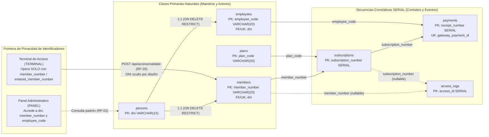

# ADR-0003: Estrategia de Identificadores de Negocio y Privacidad

* **Fecha:** 2026-10-11
* **Estado:** Aceptado

## Contexto y Problema

El diseño del esquema relacional en `gym-backend/src/main/resources/schema.sql` requiere definir la estrategia de claves primarias (PK) y claves foráneas (FK) para las siete tablas del dominio (`persons`, `members`, `employees`, `plans`, `subscriptions`, `payments` y `access_logs`), equilibrando tres fuerzas en tensión:

1. **Operatoria real de mostrador y salón:** En la recepción y en la puerta de acceso del gimnasio, los actores e ítems del catálogo se nombran mediante códigos cortos y legibles (número de carnet de socio, legajo de empleado, código de plan o número correlativo de recibo de caja). El uso de identificadores opacos de 36 caracteres (`UUID`) resulta inviable para ser tipeado por el socio en el teclado numérico de la terminal de acceso o citado verbalmente en mostrador.
2. **Privacidad por Diseño (*Privacy by Design*) frente al DNI:** Si bien el Documento Nacional de Identidad (`dni`) es el identificador natural, único e inmutable de una persona física ante el Estado, utilizarlo como código de ingreso en una terminal de autoservicio desatendida o exponerlo en pantallas visibles a terceros en el salón vulnera la privacidad del socio y facilita que cualquier conocedor de su DNI consulte su estado de mora o consuma sus accesos.
3. **Identificación de contratos y eventos temporales:** En entidades transaccionales e históricas (`subscriptions`, `payments`, `access_logs`), no existe un atributo natural único simple: un socio contrata múltiples suscripciones en el tiempo (incluso dos que inician el mismo día si la primera se cancela), realiza múltiples pagos y registra múltiples intentos de acceso que pueden coincidir en el mismo segundo. Además, como parte de la Tarea 0.2 de `organization.md`, las comparaciones físicas entre motores (`SERIAL` de PostgreSQL frente a `AUTO_INCREMENT` de MySQL y el descarte técnico de UUIDs) deben desacoplarse de `docs/entidades.md` y formalizarse arquitectónicamente.

## Decisión y Justificación

Se adopta una **estrategia híbrida de identificadores** combinada con un **límite estricto de privacidad para el DNI**:

1. **Claves Primarias Naturales de Negocio en Entidades Maestras y de Rol:**
   * **`persons.dni` (`VARCHAR(15) PRIMARY KEY`):** Identificador civil natural de la persona física, validado con `chk_person_dni CHECK (TRIM(dni) <> '')`.
   * **`members.member_number` (`VARCHAR(20) PRIMARY KEY`):** Clave natural del negocio asignada al socio (validada con `chk_member_number`). Es el único identificador que se utiliza en la terminal de acceso (`POST /api/access/validate`, RF-20) y como clave foránea en `subscriptions` y `access_logs`, evitando crear un `id` numérico redundante paralelo al número de socio.
   * **`employees.employee_code` (`VARCHAR(20) PRIMARY KEY`):** Código o legajo interno del empleado (`chk_employee_code`), referenciado directamente en `payments.employee_code` para la trazabilidad de caja.
   * **`plans.plan_code` (`VARCHAR(20) PRIMARY KEY`):** Código nemotécnico abierto del catálogo comercial (ej. `FREE`, `THREE_DAYS`, `SCHOLARSHIP`, validado con `chk_plan_code`), referenciado directamente en `subscriptions.plan_code`.
   * En las entidades JPA correspondientes (`Person`, `Member`, `Employee`, `Plan`, Tareas 1.4 a 1.7), los métodos `equals()` y `hashCode()` se implementan basándose exclusivamente en su clave natural inmutable.
2. **Claves Sustitutas Secuenciales Correlativas (`SERIAL` / `IDENTITY`) en Contratos, Comprobantes y Eventos:**
   * **`subscriptions.subscription_number` (`SERIAL PRIMARY KEY`):** Secuencia entera autoincremental de PostgreSQL (equivalente técnico del `AUTO_INCREMENT` en motores como MySQL y mapeada en JPA con `@GeneratedValue(strategy = GenerationType.IDENTITY)`). Permite identificar unívocamente cada contrato temporal (ej. "suscripción #1520") y referenciarlo con un entero liviano de 4 bytes desde `payments` y `access_logs`.
   * **`payments.receipt_number` (`SERIAL PRIMARY KEY`):** Actúa como numeración correlativa de talonario interno de recibos de caja y como referencia externa (`external_reference`) al conciliar cobros con Mercado Pago. Para la idempotencia con la pasarela externa, se complementa con la clave candidata `gateway_payment_id VARCHAR(100) UNIQUE`.
   * **`access_logs.access_id` (`SERIAL PRIMARY KEY`):** Identificador correlativo de serie temporal para cada intento de ingreso en la terminal, garantizando unicidad aun cuando ocurran dos lecturas en el mismo instante (`access_time`).
3. **Resguardo del `dni` (*Privacy by Design*):**
   * El `dni` queda confinado al ámbito administrativo interno (`persons.dni`, y como clave foránea única `dni VARCHAR(15) UNIQUE NOT NULL REFERENCES persons(dni)` en `members` y `employees`), accesible únicamente para usuarios autenticados con alcance de panel administrativo (`PANEL`, ver ADR-0012).
   * La terminal de acceso (`TERMINAL`), el contrato `POST /api/access/validate` (RF-20) y los logs estructurados de auditoría operativa (`MDC` en Tarea 4.7) operan exclusivamente con `member_number` (o `entered_member_number`), sin solicitar, transmitir ni mostrar jamás el `dni` del socio.

### Alternativas Descartadas

* **Identificadores universales `UUID v4` en todas las tablas:** Se descartó porque en la operatoria real de un gimnasio ningún socio ni recepcionista identifica un carnet, una suscripción o un recibo de caja mediante una cadena hexadecimal aleatoria de 36 caracteres (ej. `550e8400-e29b-41d4-a716-446655440000`). Además, en un monolito con una única base de datos PostgreSQL centralizada no existe generación distribuida desconectada que justifique UUIDs, y su aleatoriedad degrada la localidad espacial de las páginas en los índices B-Tree frente a secuencias `SERIAL` de 32 bits o códigos cortos `VARCHAR(20)`.
* **Exposición del `dni` como clave primaria de `members` y código de ingreso en la terminal:** Se descartó por razones de privacidad y seguridad (*Privacy by Design*). El DNI es un dato público sensible y predecible; usarlo en la terminal desatendida permitiría que terceros prueben números de documento ajenos en puerta para averiguar si una persona asiste al gimnasio, qué plan posee o si registra deuda (`PAYMENT_OVERDUE`).
* **Claves primarias compuestas `(member_number, start_date)` en `subscriptions` y `(member_number, access_time)` en `access_logs`:** Se descartó en `subscriptions` porque la restricción de exclusión `no_overlap_subscriptions` ignora las filas con `status = 'CANCELLED'`; por lo tanto, si una suscripción se cancela por error de carga y se da de alta su reemplazo con el mismo `start_date`, una clave compuesta `(member_number, start_date)` fallaría por colisión de clave primaria. Asimismo, obligaría a propagar dos columnas (incluyendo un `TIMESTAMPTZ`) como clave foránea hacia `payments` y `access_logs`. En `access_logs`, `(member_number, access_time)` tampoco es viable porque `member_number` es nulo cuando el número tipeado no existe (`MEMBER_NOT_FOUND`) y dos eventos pueden compartir el mismo instante.

## Flujo Visual

## Compensaciones y Consecuencias

* **Ganancias / Beneficios:**
  * **Alineación directa con el lenguaje ubicuo del negocio:** Las claves primarias coinciden exactamente con los identificadores que emplean los cajeros, administradores y socios (`member_number`, `employee_code`, `plan_code`, `subscription_number`, `receipt_number`), eliminando traducciones innecesarias entre un `id` técnico interno y un código de negocio externo.
  * **Protección efectiva de la identidad civil (*Privacy by Design*):** El `dni` nunca viaja hacia ni desde la terminal de acceso ni se registra en los logs operativos de validación, reduciendo la superficie de exposición de datos personales.
  * **Eficiencia en uniones (`JOIN`) e índices:** Las referencias desde `subscriptions` y `access_logs` hacia `members` y `plans` contienen directamente el `member_number` y el `plan_code`, permitiendo resolver filtros frecuentes sin requerir un `JOIN` adicional solo para traducir una clave subrogada.
* **Costos / Deuda Técnica:**
  * **Inmutabilidad obligatoria de las claves naturales una vez creadas:** Dado que `member_number`, `employee_code` y `plan_code` actúan como claves primarias referenciadas sin `ON UPDATE CASCADE`, los contratos de modificación (`PUT /api/members/{member_number}` en RF-05, `PUT /api/employees/{employee_code}` en RF-09 y `PUT /api/plans/{plan_code}` en RF-25) prohíben alterar dichos códigos tras el alta.
  * **Posibles saltos en la numeración `SERIAL`:** Las secuencias de PostgreSQL (`subscription_number`, `receipt_number`, `access_id`) avanzan fuera del control transaccional y pueden presentar huecos si una transacción hace *rollback* (por ejemplo, un cobro rechazado por la restricción `chk_payment_amount` o un solapamiento `no_overlap_subscriptions`). Se asume conscientemente porque `receipt_number` representa un comprobante operativo interno de caja y no una numeración fiscal homologada ante AFIP/ARCA.
