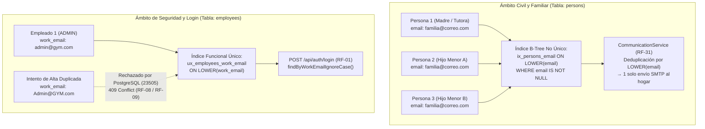

# ADR-0004: Segregación Semántica de Correo Electrónico

* **Fecha:** 2026-10-11
* **Estado:** Aceptado

## Contexto y Problema

En el dominio del gimnasio, el correo electrónico cumple dos propósitos semántica y operativamente incompatibles según el actor y el caso de uso:

1. **Canal de comunicación civil y familiar (`persons`):** Se utiliza para enviar comunicados generales del gimnasio (`POST /api/communications/broadcast`, RF-31) y avisos automáticos de próximo vencimiento de suscripción (`RF-32`). En la práctica cotidiana de un gimnasio, es frecuente que **hermanos menores de edad, hijos y padres o parejas compartan una única dirección de correo electrónico familiar** (por ejemplo, el correo de la madre o tutor responsable). Si el esquema impusiera una restricción `UNIQUE` sobre el correo de la persona física, el sistema rechazaría con `409 Conflict` el alta del segundo integrante de la familia o forzaría al recepcionista a cargar correos ficticios o dejar solo teléfono.
2. **Credencial corporativa de autenticación (`employees`):** El personal administrativo y operativo (`ADMIN` y `STAFF`) inicia sesión en el sistema mediante `POST /api/auth/login` (RF-01) proveyendo su correo laboral y contraseña. A diferencia del correo de contacto civil, una credencial de acceso exige **unicidad física absoluta e intransferibilidad**: dos empleados no pueden compartir la misma cuenta de login, ya que cada cobro en mostrador (`payments.employee_code`) y cada acción administrativa debe ser individualmente auditable. Asimismo, el estándar SQL evalúa las restricciones `UNIQUE` sobre columnas `VARCHAR` de forma sensible a mayúsculas (*case-sensitive*), lo cual permitiría registrar por error `Admin@gym.com` y `admin@gym.com` como dos cuentas distintas, provocando ambigüedad en el inicio de sesión.

## Decisión y Justificación

Se decide **segregar semántica y físicamente el correo electrónico** en dos atributos con reglas de integridad e indexación diferenciadas en `gym-backend/src/main/resources/schema.sql`:

1. **`persons.email` (`VARCHAR(255)` nullable, NO único) — Canal de Contacto Civil y Familiar:**
   * No posee restricción `UNIQUE`, permitiendo que múltiples registros de `persons` (y sus respectivos roles `members`) compartan la misma dirección de correo familiar sin conflictos.
   * La obligatoriedad de contacto de la persona se resuelve de forma disyuntiva mediante `CONSTRAINT chk_person_contact CHECK (email IS NOT NULL OR phone IS NOT NULL)` y se impide el ingreso de cadenas en blanco mediante `CONSTRAINT chk_person_email CHECK (TRIM(email) <> '')`.
   * Se indexa mediante el índice funcional parcial no único `CREATE INDEX IF NOT EXISTS ix_persons_email ON persons (LOWER(email)) WHERE email IS NOT NULL;` para acelerar búsquedas sin penalizar filas que solo informan teléfono.
   * En el servicio de comunicaciones (`CommunicationService`, Tarea 2.13, RF-31), cuando se emite un comunicado masivo, las direcciones `persons.email` se **deduplican de forma insensible a mayúsculas** antes del despacho SMTP para que una familia que comparte correo reciba un único ejemplar del mensaje.
2. **`employees.work_email` (`VARCHAR(255) NOT NULL`) — Credencial Corporativa de Autenticación:**
   * Es obligatorio y no vacío (`CONSTRAINT chk_employee_work_email CHECK (TRIM(work_email) <> '')`), aislado exclusivamente en la tabla `employees`.
   * Su unicidad insensible a mayúsculas y minúsculas (*case-insensitive*) se impone a nivel de motor PostgreSQL mediante el índice funcional único:
     ```sql
     CREATE UNIQUE INDEX IF NOT EXISTS ux_employees_work_email ON employees (LOWER(work_email));
     ```
   * En la capa de persistencia y negocio (`EmployeeRepository.findByWorkEmailIgnoreCase` en Tarea 1.11 y `EmployeeService` en Tarea 2.4), tanto la autenticación en `POST /api/auth/login` (RF-01) como las validaciones de alta/modificación (RF-08, RF-09) operan de manera *case-insensitive*, garantizando correspondencia exacta con el índice `ux_employees_work_email`.

### Alternativas Descartadas

* **Columna única `persons.email` con restricción `UNIQUE` utilizada simultáneamente para contacto y login:** Se descartó porque bloquea un caso de uso real y cotidiano del gimnasio: inscribir a dos hijos menores de edad bajo el correo electrónico de su padre o tutor dispararía una violación de unicidad (`23505` / `409 Conflict`). Además, acoplaría el correo personal del empleado (que puede compartir o cambiar) con su credencial corporativa de acceso al sistema.
* **Restricción `UNIQUE (work_email)` estándar en la definición de la tabla `employees` sin índice funcional `LOWER()`:** Se descartó porque en PostgreSQL con intercalación (*collation*) estándar, la comparación de `VARCHAR` es sensible a mayúsculas (`'Admin@gym.com' <> 'admin@gym.com'`). Depender únicamente de que la aplicación convierta a minúsculas antes de guardar (`toLowerCase()`) vulnera el principio de defensa en profundidad declarativa en la base de datos ante inserciones directas o fallos de normalización en código.
* **Autenticación del personal mediante `dni` o `employee_code` prescindiendo de `work_email`:** Se descartó porque el requerimiento funcional **RF-01** (`POST /api/auth/login`) especifica explícitamente la autenticación mediante correo de trabajo (`work_email`) y contraseña, alineándose con las prácticas estándar de gestión de identidades corporativas y gestores de contraseñas en navegadores web.

## Flujo Visual



## Compensaciones y Consecuencias

* **Ganancias / Beneficios:**
  * **Soporte nativo para grupos familiares y menores de edad:** Múltiples socios pueden registrar el mismo `persons.email` de contacto sin fricciones en mostrador ni trucos operativos, manteniendo garantizado al menos un canal de contacto mediante `chk_person_contact`.
  * **Inmunidad ante duplicados por capitalización en login:** El índice funcional `ux_employees_work_email ON employees (LOWER(work_email))` impide físicamente que existan dos cuentas de empleado que solo difieran en mayúsculas/minúsculas, asegurando autenticaciones deterministas en `POST /api/auth/login` (RF-01).
  * **Eficiencia en envíos masivos (RF-31):** La combinación de un correo de contacto no único con la deduplicación previa al envío evita saturar la casilla familiar con correos repetidos en comunicados generales (`ALL`, `ACTIVE`, `OVERDUE`).
* **Costos / Deuda Técnica:**
  * **Dos campos de correo cuando un empleado tiene contacto personal distinto del laboral:** Una persona que además es empleada posee `persons.email` (contacto civil opcional) y `employees.work_email` (credencial obligatoria de login). Los DTOs y formularios de administración de personal (RF-08, RF-09) deben distinguir claramente ambos campos en la interfaz.
  * **Traducción de violación de índice funcional en el manejador de excepciones:** Cuando una inserción o actualización viola `ux_employees_work_email`, PostgreSQL arroja un error `23505` (*unique_violation*) referenciando el nombre del índice. El `GlobalExceptionHandler` (Tarea 3.1) y `EmployeeService` (Tarea 2.4) deben mapear esta condición limpiamente a `409 Conflict` sin exponer trazas SQL al cliente.
