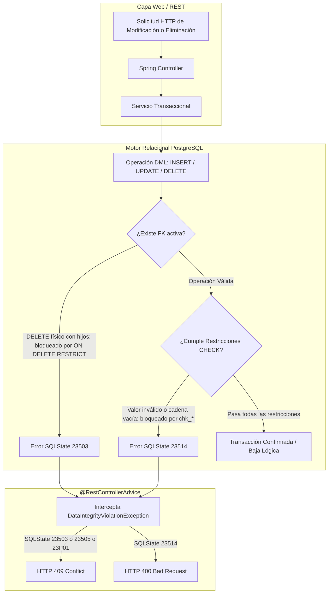

# ADR-0005: Conservación del Historial e Integridad Declarativa

* **Fecha:** 2026-10-11
* **Estado:** Aceptado

## Contexto y Problema

En un sistema de gestión integral de gimnasio, los registros contables (`payments`), los períodos contractuales acordados (`subscriptions`) y las trazas de auditoría de los molinetes físicos (`access_logs`) constituyen activos críticos cuyo borrado o corrupción accidental conlleva responsabilidades legales, impositivas y de seguridad física.

Frecuentemente, los esquemas de bases de datos adoptan políticas permisivas de eliminación física mediante borrado en cascada (`ON DELETE CASCADE`) o anulación de referencias (`ON DELETE SET NULL`) para facilitar la operatoria de desarrollo o la eliminación de entidades maestras (como socios o empleados). Asimismo, suele delegarse la validación de integridad exclusivamente a la capa de aplicación (validaciones imperativas en Java mediante Bean Validation).

Este enfoque presenta riesgos graves para el sistema:
1. Si un operador o proceso elimina una fila en `members` o `employees`, un mecanismo `CASCADE` destruiría silenciosamente comprobantes fiscales en `payments` y registros forenses en `access_logs`.
2. Un mecanismo `SET NULL` en claves foráneas distorsionaría la semántica forense: en `access_logs`, una clave foránea `member_number` nula tiene un significado semántico unívoco e inmutable (`denied_reason = 'MEMBER_NOT_FOUND'`). Si se permitiese `SET NULL` tras borrar un socio, los intentos históricos de socios reales quedarían indistinguibles de intrusiones con credenciales inexistentes.
3. Las validaciones exclusivas en la capa de aplicación son susceptibles a bypass mediante concurrencia no serializada, cargas masivas o scripts administrativos ejecutados directamente sobre la base de datos.

Por ende, se requiere una estrategia de defensa en profundidad que garantice la inmutabilidad histórica, el bloqueo de eliminaciones físicas destructivas y la validación matemática de estados en el motor relacional.

## Decisión y Justificación

Se adopta una política estricta de **defensa en profundidad e integridad declarativa en el motor relacional PostgreSQL**, complementada con desactivaciones lógicas y traducción determinista de excepciones en la capa web:

1. **Restricción Universal de Eliminación (`ON DELETE RESTRICT`):**
   Todas las claves foráneas del modelo relacional (`members.dni`, `employees.dni`, `subscriptions.member_number`, `subscriptions.plan_code`, `payments.subscription_number`, `payments.employee_code`, `access_logs.member_number`, `access_logs.subscription_number`) declaran taxativamente `ON DELETE RESTRICT`. Queda estrictamente prohibido el uso de `ON DELETE CASCADE` y `ON DELETE SET NULL`. Cualquier intento de eliminar físicamente un registro padre referenciado por transacciones, contratos o logs es bloqueado por el motor de base de datos.
2. **Ciclo de Vida mediante Desactivación Lógica:**
   Las entidades maestras y transaccionales implementan estados lógicos explícitos:
   - Socios: `members.status IN ('ACTIVE', 'INACTIVE')` (baja administrativa RF-05/RF-06).
   - Personal: `employees.active BOOLEAN DEFAULT TRUE` (inhabilitación de acceso RF-10).
   - Planes: `plans.active BOOLEAN DEFAULT TRUE` (discontinuación comercial RF-25).
   - Suscripciones: `subscriptions.status IN ('ACTIVE', 'CANCELLED')` (rescisión contractual RF-15).
   - Pagos: `payments.status IN ('PENDING', 'PAID', 'FAILED', 'CANCELLED')` (anulación de cobro erróneo RF-19).
3. **Restricciones Declarativas `CHECK` Exhaustivas:**
   El motor valida el dominio exacto de datos e invariantes cruzadas mediante restricciones declarativas a nivel de tabla:
   - Identidad y contacto: `chk_person_contact` exige que al menos exista `email` o `phone` no nulos. Restricciones `chk_*_not_blank` (`TRIM(...) <> ''`) sobre nombres, documentos, códigos y correos previenen cadenas en blanco o espaciados vacíos.
   - Restricciones monetarias y de rangos: `chk_subscription_dates` (`end_date > start_date`), `chk_subscription_price` (`price >= 0`), `chk_subscription_discount` (`discount IS NULL OR (discount >= 0 AND discount <= price)`), y `chk_payment_amount` (`amount > 0`).
   - Coherencia transaccional: `chk_payment_employee` (`employee_code IS NOT NULL OR payment_method = 'MERCADO_PAGO'`).
   - Coherencia forense de accesos: `chk_access_logic` asegura que un acceso `GRANTED` tenga obligatoriamente `member_number` y `subscription_number` asociados sin motivo de denegación, mientras que `DENIED` exige `denied_reason`. Complementariamente, `chk_access_not_found` condiciona `member_number IS NULL` estricta y únicamente al motivo `MEMBER_NOT_FOUND`.
4. **Traducción Determinista de `SQLState` en la Capa REST:**
   En lugar de duplicar validaciones concurrentes complejas en servicios Java, la base de datos se mantiene como la fuente de verdad definitiva de integridad. El manejador global `@RestControllerAdvice` (Tarea 3.1) intercepta `DataIntegrityViolationException` extrayendo el código estándar `SQLState`:
   - `23505` (violación de unicidad / unique violation) $\rightarrow$ `409 Conflict`.
   - `23503` (violación de clave foránea / foreign_key_violation) $\rightarrow$ `409 Conflict`.
   - `23P01` (violación de exclusión / exclusion_violation) $\rightarrow$ `409 Conflict`.
   - `23514` (violación de restricción CHECK / check_violation) $\rightarrow$ `400 Bad Request`.

### Alternativas Descartadas

* **Borrado en Cascada (`ON DELETE CASCADE`):** Descartado taxativamente. Permitir que la eliminación de un socio o plan arrastre suscripciones, pagos o accesos destruiría la trazabilidad fiscal y auditoría forense del negocio.
* **Anulación de Clave Foránea (`ON DELETE SET NULL`):** Descartado porque rompe la invariante de auditoría forense en `access_logs`. Si `access_logs.member_number` se convirtiera en `NULL` tras borrar un socio, la fila violaría o confundiría la regla `chk_access_not_found`, haciendo indistinguible un socio eliminado de un intento anónimo con número inexistente.
* **Validación Exclusiva en Capa de Aplicación (Spring / Hibernate Validator):** Descartado como mecanismo único. Aunque la aplicación valida formatos de entrada con anotaciones Bean Validation, confiar únicamente en el backend expone el sistema a condiciones de carrera concurrentes y a inconsistencias introducidas por scripts de migración o mantenimiento manual de base de datos.

## Flujo Visual

## Compensaciones y Consecuencias

* **Ganancias / Beneficios:**
  * **Defensa en Profundidad:** La integridad referencial y las reglas de dominio están garantizadas matemáticamente por el motor relacional, independientemente de errores en el código Java o accesos directos por consola.
  * **Inmutabilidad y Preservación Forense:** Los registros financieros y las trazas de molinete nunca pueden borrarse por accidente mientras existan en el sistema.
  * **Mapeo Limpio de Errores:** La centralización de códigos `SQLState` en `@RestControllerAdvice` proporciona respuestas HTTP semánticas estandarizadas (RFC 7807, ver Tarea 3.1) sin duplicar lógica de validación repetitiva en los repositorios.
* **Costos / Deuda Técnica:**
  * **Imposibilidad de Eliminación Física Directa:** Para depurar datos de prueba o registros erróneos, los desarrolladores y administradores no pueden ejecutar simples sentencias `DELETE`, debiendo utilizar siempre transiciones de estado lógicas o scripts ordenados de sanitización en entornos de pruebas.
  * **Dependencia de Códigos Propietarios de Motor:** La extracción de `SQLState` está acoplada al estándar ANSI/PostgreSQL implementado por el driver JDBC; cualquier cambio hipotético de motor exigiría verificar la compatibilidad de dichos códigos.
