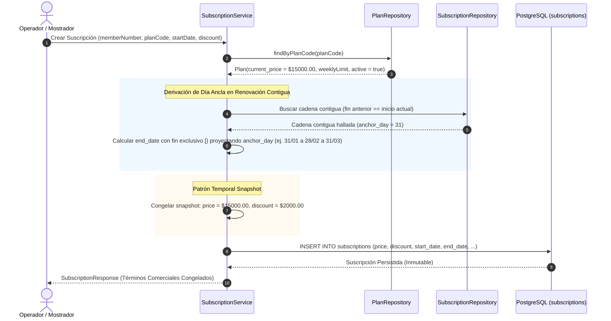

# ADR-0006: Catálogo Tarifario Dinámico, Inmutabilidad Contractual y Snapshot de Precios

* **Fecha:** 2026-10-11
* **Estado:** Aceptado

## Contexto y Problema

En la operación del gimnasio, las condiciones comerciales y aranceles de los planes (`plans`) evolucionan continuamente debido a ajustes inflacionarios, promociones de temporada o reestructuración de servicios. Al mismo tiempo, la institución otorga becas totales o cortesías ($0.00) y descuentos promocionales parciales pactados al momento de la suscripción.

El diseño del modelo tarifario enfrenta dos tensiones fundamentales:
1. **Inmutabilidad de la Deuda Histórica vs. Actualización del Catálogo:** Cuando la administración actualiza el precio de lista (`current_price`) de un plan en la tabla `plans`, las suscripciones activas, vencidas o en curso de pago nunca deben ver alterado retroactivamente su importe pactado ni el saldo pendiente de liquidación. Si el saldo de una suscripción se calculara dinámicamente consultando el precio actual del plan asociado mediante un `JOIN`, un aumento tarifario encarecería retroactivamente contratos ya devengados o cuotas en curso.
2. **Preservación del Día Ancla en Renovaciones Encadenadas Mensuales:** En planes con vigencia mensual calculados mediante la API estándar de fechas Java (`TemporalAmount` / `plusMonths(1)`), surgen derivas indeseadas al transicionar entre meses de distinta longitud. Si un socio inicia su abono un 31 de enero, la renovación inmediata culmina el 28 de febrero. Si la siguiente renovación mensual sumara ciegamente un mes a partir del 28 de febrero, el nuevo vencimiento caería el 28 de marzo, perdiendo de forma irreversible los días 29, 30 y 31 ("deriva de fin de mes"). El esquema relacional `schema.sql` se encuentra formalmente cerrado y congelado, prohibiendo explícitamente agregar columnas técnicas como `anchor_day` para almacenar el día original.

## Decisión y Justificación

Se resuelven estas tensiones mediante la adopción del **Patrón Temporal Snapshot**, inmutabilidad estricta de términos contractuales en `subscriptions` y derivación algorítmica del día ancla sobre la cadena contigua de suscripciones:

1. **Catálogo Dinámico de Planes (`plans`):**
   Se descartan los enums rígidos de modalidades en el código Java y se implementa una tabla de catálogo `plans` con `plan_code`, `name`, `weekly_limit` (nulo para pase libre o entero positivo), `current_price DECIMAL(19,2) >= 0` y `active BOOLEAN`. La modificación de `current_price` opera únicamente como precio de lista sugerido para futuras contrataciones.
2. **Patrón Temporal Snapshot en Suscripciones:**
   Al crear una nueva suscripción (`subscriptions`), el servicio congela en la fila del contrato:
   - `subscriptions.price`: Copia exacta del valor vigente de `plans.current_price` al instante de la transacción.
   - `subscriptions.discount`: Monto fijo bonificado pactado al alta ($0 \le discount \le price$), garantizado por la restricción `chk_subscription_discount`.
   - **Inmutabilidad Contractual (RF-14):** Una vez persistida, los campos `plan_code`, `price`, `discount`, `start_date` y `end_date` son estrictamente inmutables. El endpoint de edición `PUT /api/subscriptions/{id}` permite modificar única y exclusivamente el campo `comments`. Si un socio desea cambiar de plan, no se muta el contrato vigente: debe contratarse una nueva suscripción para el período siguiente (o tras la baja lógica del contrato actual), capturando el snapshot del nuevo plan seleccionado.
3. **Manejo Natural de Becas y Cortesías:**
   Las cortesías y becas del 100% se modelan de forma nativa en el modelo matemático asignando `price = 0.00` o `discount = price`. Esto permite que el socio becado transite naturalmente las reglas de validación de cuota al día ($\sum amount_{\text{PAID}} \ge price - discount \implies 0.00 \ge 0.00$) sin requerir banderas booleanas especiales de bypass ni bifurcaciones condicionales en el código.
4. **Cálculo Determinista de `end_date` y Derivación del Día Ancla (Tarea 2.6):**
   El cálculo de vigencia se efectúa en el backend inyectando el bean `Clock`, modelando intervalos semiabiertos `[start_date, end_date)` con extremo final estrictamente exclusivo ($start\_date \le now < end\_date$): en el instante exacto `end_date` el acceso físico queda caducado (sin utilizar marcas artificiales como `23:59:59`).
   - En renovaciones adelantadas ($now < end_{actual}$), el nuevo período inicia exactamente en el instante de finalización del anterior ($start_{nuevo} = end_{actual}$).
   - Para preservar el día de vencimiento original sin columnas técnicas en la base, el servicio inspecciona hacia atrás la cadena de suscripciones contiguas no canceladas del socio donde `start_date_actual == end_date_anterior`.
   - Se identifica la primera suscripción originaria de dicha cadena contigua y se extrae su día del mes calendario (`anchor_day`).
   - **Ejemplo fechado de renovación con anclaje:**
     - Suscripción inicial: rango `[2026-01-31T10:00:00-03:00, 2026-02-28T10:00:00-03:00)` (fin exclusivo en año no bisiesto).
     - Renovación adelantada registrada con Clock en `2026-02-20T10:00:00-03:00`: el inicio se encadena contiguamente en `2026-02-28T10:00:00-03:00` y, aplicando el `anchor_day = 31` derivado, se proyecta el fin al `2026-03-31T10:00:00-03:00`, generando el nuevo período `[2026-02-28T10:00:00-03:00, 2026-03-31T10:00:00-03:00)` con fin exclusivo y sin deriva temporal acumulativa.
   - Esta solución respeta rigurosamente la regla del proyecto de no alterar `schema.sql`, deduciendo el estado de negocio a partir de la historia contigua existente.

### Alternativas Descartadas

* **Cálculo Dinámico de Deuda mediante `JOIN` con `plans.current_price`:** Descartado categóricamente. Cada cambio en el catálogo tarifario alteraría retroactivamente los importes debidos y los comprobantes contables históricos de suscripciones pasadas, violando los principios contables elementales y los derechos del consumidor.
* **Incorporación de Columna `anchor_day` en `subscriptions`:** Descartado porque violaría la directriz del proyecto que estipula que `schema.sql` es inmutable y no debe modificarse para solucionar requerimientos de software.
* **Tabla Histórica de Precios con Rangos Temporales (`plan_prices_history`):** Descartado por sobreingeniería. Para las necesidades de suscripción mensual del gimnasio, capturar la instantánea (snapshot) de `price` y `discount` directamente en la tupla `subscriptions` satisface la inmutabilidad contractual con mínima complejidad estructural y sin consultas relacionales temporales complejas.

## Flujo Visual

## Compensaciones y Consecuencias

* **Ganancias / Beneficios:**
  * **Inmutabilidad y Seguridad Jurídica:** Las modificaciones futuras en el catálogo de aranceles no impactan bajo ninguna circunstancia los contratos en curso ni los saldos históricos adeudados.
  * **Consistencia Calendario sin Migraciones DDL:** Se garantiza que los socios no pierdan días de abono por variaciones de longitud de los meses (31, 30, 28 días) resolviendo la derivación puramente en la capa de dominio sin requerir columnas adicionales en `schema.sql`.
  * **Modelado Unificado de Becas:** Las cortesías operan bajo la misma matemática contable de cobros y saldos sin requerir banderas o casos de excepción en la base de datos ni en la lógica de negocio.
* **Costos / Deuda Técnica:**
  * **Cálculo Recursivo/Iterativo de la Cadena Contigua:** Derivar el día ancla inspeccionando suscripciones contiguas previas impone una consulta adicional en la creación de renovaciones, requiriendo que la cadena esté indexada por `member_number` (garantizado por `ix_subscriptions_member_number`).
  * **Duplicación Controlada de Datos:** El valor monetario se almacena redundantemente en cada registro de `subscriptions`, compensando el espacio en disco con simplicidad de consulta y total aislamiento temporal.
* **Condición de Revisión:**
  * Este mecanismo debe revisarse si el gimnasio incorpora planes plurimensuales (trimestrales, anuales) o planes basados en créditos/clases en lugar de períodos temporales continuos.
