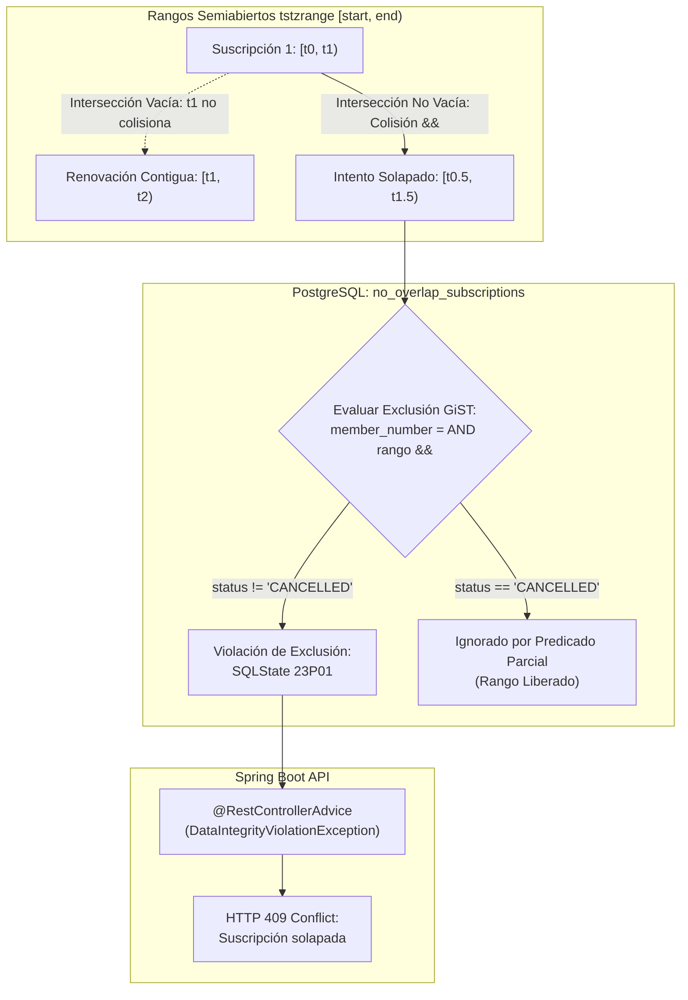

# ADR-0007: Prevención de Solapamiento Temporal de Suscripciones mediante Restricción de Exclusión GiST

* **Fecha:** 2026-10-11
* **Estado:** Aceptado

## Contexto y Problema

En las operaciones cotidianas de un gimnasio, las suscripciones de los socios poseen vigencia delimitada en el tiempo mediante marcas temporales de inicio (`start_date`) y finalización (`end_date`). Para evitar facturación duplicada, ambigüedades en la asignación de planes y conflictos al validar el acceso en molinetes, el sistema exige una invariante crítica de negocio: **un socio no puede poseer dos suscripciones vigentes cuyos intervalos temporales se solapen**.

Adicionalmente, el modelo operativo impone dos requerimientos específicos:
1. **Renovación Contigua Ininterrumpida:** Un socio debe poder contratar por adelantado una renovación cuyo período inicie en el instante exacto en que expira su suscripción actual ($end_1 = start_2$), sin que el sistema rechace la operación por colisión en el límite.
2. **Liberación Inmediata ante Rescisión Contractual:** Si una suscripción es cancelada administrativamente (`status = 'CANCELLED'`), el rango temporal que ocupaba debe quedar liberado de inmediato para permitir que se contrate o ajuste un nuevo plan en ese mismo período.

La validación tradicional en aplicaciones web consiste en ejecutar un `SELECT COUNT(*)` previo en Java para verificar si existen suscripciones que colisionen antes de emitir el `INSERT`. Bajo niveles habituales de aislamiento de transacciones (como `READ COMMITTED`), dos peticiones concurrentes simultáneas pueden pasar la validación previa al mismo tiempo (vulnerabilidad *Time-of-Check to Time-of-Use* o TOCTOU), insertando suscripciones solapadas en la base de datos y corrompiendo la consistencia del negocio.

## Decisión y Justificación

Se decide delegar la garantía de no solapamiento directamente al motor de base de datos PostgreSQL utilizando una **Restricción de Exclusión GiST** respaldada por la extensión `btree_gist`:

1. **Habilitación de la Extensión `btree_gist`:**
   En `schema.sql` se ejecuta:
   ```sql
   CREATE EXTENSION IF NOT EXISTS btree_gist;
   ```
   Esto permite combinar tipos escalares estándar (como `VARCHAR(20)` para `member_number` mediante el operador `=`) con tipos de rangos en un único índice de exclusión GiST.
2. **Definición de la Restricción de Exclusión:**
   En la tabla `subscriptions`, se declara la restricción:
   ```sql
   CONSTRAINT no_overlap_subscriptions EXCLUDE USING gist (
       member_number WITH =,
       tstzrange(start_date, end_date, '[)') WITH &&
   ) WHERE (status != 'CANCELLED');
   ```
3. **Semántica de Rangos Semiabiertos `[)`:**
   Se utiliza el constructor de rangos con zona horaria `tstzrange` configurado con intervalo semiabierto `[)` (inclusivo en `start_date`, exclusivo en `end_date`). Esta formulación matemática modela con precisión la continuidad de los contratos:
   - Una suscripción $S_1$ con rango $[t_0, t_1)$ y una renovación contigua $S_2$ con rango $[t_1, t_2)$ tienen una intersección vacía ($[t_0, t_1) \cap [t_1, t_2) = \emptyset$). El instante $t_1$ pertenece exclusivamente a $S_2$, eliminando falsos positivos en renovaciones encadenadas.
4. **Predicado Parcial de Liberación Inmediata:**
   La cláusula `WHERE (status != 'CANCELLED')` excluye del índice de exclusión a todas las suscripciones rescindidas. Al cambiar el estado a `CANCELLED`, la fila deja de participar en el índice GiST, liberando el rango temporal para nuevas suscripciones sin necesidad de borrado físico.
5. **Traducción Global del Conflicto Concurrente:**
   Si una inserción concurrente colisiona temporalmente, PostgreSQL aborta la transacción arrojando la excepción con código `SQLState 23P01` (`exclusion_violation`). El manejador global `@RestControllerAdvice` (Tarea 3.1) captura esta violación y responde deterministamente con código HTTP `409 Conflict`, brindando una barrera atómica infalible contra condiciones de carrera.

### Alternativas Descartadas

* **Validación por `SELECT` previo en capa de servicio (Java):** Descartado taxativamente. Bajo aislamiento `READ COMMITTED`, es vulnerable a condiciones de carrera (TOCTOU). Dos transacciones simultáneas no ven los cambios no confirmados de la otra y ambas realizan el `INSERT`, generando registros solapados.
* **Intervalos Cerrados `[]`:** Descartado. Un intervalo cerrado incluye ambos extremos ($[start, end]$). Si $S_1$ termina en $t_1$ y $S_2$ comienza en $t_1$, el operador de solapamiento `&&` detecta colisión en el punto discreto $t_1$, impidiendo las renovaciones continuas del servicio.
* **Bloqueo a Nivel de Tabla (`LOCK TABLE subscriptions`):** Descartado. Serializaría globalmente las altas de suscripciones de todos los socios del gimnasio, degradando severamente el rendimiento y la escalabilidad del sistema ante una regla que solo compete al ámbito individual de cada socio (`member_number`).

## Flujo Visual



## Compensaciones y Consecuencias

* **Ganancias / Beneficios:**
  * **Consistencia Concurrente Absoluta:** Garantía matemática a nivel motor contra cualquier condición de carrera o transacción simultánea sin requerir bloqueos pesimistas manuales en Java.
  * **Soporte Perfecto de Renovaciones Contiguas:** La semántica semiabierta `[)` permite el encadenamiento natural de períodos sin perder ni solapar fracciones de segundo.
  * **Reversibilidad y Liberación Inmediata:** La cláusula parcial `WHERE (status != 'CANCELLED')` habilita la rectificación de abonos cancelados manteniendo intacta la auditoría histórica.
* **Costos / Deuda Técnica:**
  * **Acoplamiento Fuerte a PostgreSQL:** Las restricciones de exclusión GiST y el tipo de dato de rango son características avanzadas de PostgreSQL que no están estandarizadas en ANSI SQL ni soportadas por bases de datos embebidas tradicionales como H2 o SQLite. Esto obliga a ejecutar las suites de integración contra una instancia real de PostgreSQL (conforme a ADR-0014).
  * **Sobrecarga de Índices GiST:** El mantenimiento de árboles GiST presenta una penalización computacional marginalmente superior frente a índices B-Tree estándar durante operaciones de inserción y actualización, la cual resulta plenamente despreciable dado el volumen de transacciones de un gimnasio.
