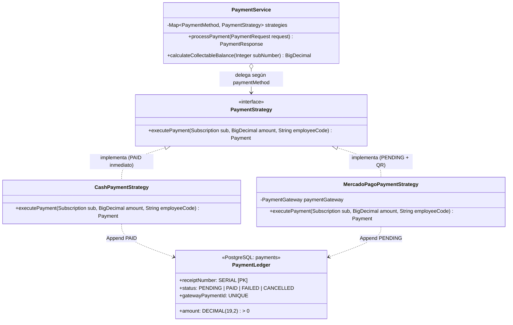

# ADR-0008: Modelo de Pagos: Patrón Ledger Inmutable y Patrón Strategy según Método

* **Fecha:** 2026-10-11
* **Estado:** Aceptado

## Contexto y Problema

El sistema de gestión del gimnasio administra cobranzas de suscripciones que admiten pagos totales o parciales (en cuotas) en moneda de curso legal (Pesos Argentinos, `ARS`). La recepción de cobros se realiza principalmente mediante dos modalidades operativas distintas:
1. **Efectivo en mostrador (`CASH`):** Cobro presencial inmediato gestionado por un empleado de recepción con acreditación instantánea.
2. **Pasarela digital (`MERCADO_PAGO`):** Generación de código QR o intención de pago asíncrona, sujeta a confirmación diferida mediante webhooks o re-consultas API.

Este escenario impone estrictos desafíos de integridad contable y diseño:
- **Trazabilidad Contable e Inmutabilidad:** Los cobros efectivamente percibidos y acreditados (`PAID`) nunca deben alterarse ni eliminarse físicamente, incluso si la suscripción subyacente es cancelada administrativamente por el socio.
- **Prevención de Sobrepagos Concurrentes:** Deben evitarse sobrepagos accidentales o malintencionados. Cuando se emite un cobro digital con QR en estado pendiente (`PENDING`), dicho importe debe reservar saldo para que el cajero en mostrador u otra terminal no intente cobrar simultáneamente un monto que exceda la deuda real restante.
- **Diversidad de Canales de Cobro:** La lógica de liquidación, validación de cajero y ciclo de estados varía sustancialmente según el medio de pago: el efectivo requiere la presencia obligatoria de un empleado logueado (`employee_code`), mientras que la pasarela digital vincula identificadores externos idempotentes (`gateway_payment_id`) sin requerir cajero físico.

## Decisión y Justificación

Se resuelve la gestión de cobros implementando el **Patrón Ledger Inmutable (Libro Mayor)** en el modelo relacional, control de saldo derivado con reserva de pendientes y el **Patrón GoF Strategy** en la capa de servicios:

1. **Patrón Ledger Inmutable en `payments`:**
   La tabla `payments` opera conceptualmente como un libro contable de sólo adición (*append-only ledger*):
   - Cada cobro registrado posee su propio identificador correlativo (`receipt_number SERIAL`), fecha `created_at` inmutable y monto positivo estricto (`chk_payment_amount CHECK (amount > 0)`).
   - **Independencia ante Cancelación Contractual (RF-15):** Si una suscripción se cancela (`subscriptions.status = 'CANCELLED'`), los pagos en estado `PAID` permanecen intactos e inalterables para fines de balances contables y arqueos de caja.
   - **Semántica Restringida de Cancelación (RF-19):** El estado `payments.status = 'CANCELLED'` queda reservado con exclusividad al rol `ADMIN` para anular un error operativo de carga de caja manual.
   - **Descuento Único y Moneda Nacional:** No existe columna de descuento en `payments`. El descuento pactado reside únicamente en `subscriptions.discount`. Todos los importes se manejan en `DECIMAL(19,2)` sin conversión multimoneda.
2. **Cálculo Derivado de Saldos y Reserva de Cobros Pendientes (Tarea 0.7 / 2.8):**
   No existe una columna mutable `balance` o `paid_amount` en `subscriptions`. El estado financiero se calcula dinámicamente:
   - **Saldo Disponible para Cobrar (en checkout / creación de pago):**
     $$\text{Saldo Cobrable} = (\text{price} - \text{discount}) - \sum \text{amount}_{\text{PAID}} - \sum \text{amount}_{\text{PENDING}}$$
     Esta fórmula reserva el saldo ante códigos QR emitidos en estado `PENDING`, impidiendo sobrepagos si otro canal intenta cobrar antes del vencimiento del QR. Si un nuevo pago supera este saldo, el backend rechaza la transacción con `409 Conflict`.
   - **Condición de Acceso en Molinete (Access Rule 3):**
     $$\sum \text{amount}_{\text{PAID}} \ge (\text{price} - \text{discount})$$
     Para franquear el acceso físico al gimnasio, se computan estrictamente los pagos consolidados `PAID` (los cobros en estado `PENDING` no habilitan el paso).
3. **Patrón GoF Strategy (`PaymentStrategy`):**
   Se desacopla la ejecución y liquidación de pagos mediante la interfaz polimórfica `PaymentStrategy`:
   - `CashPaymentStrategy`: Valida que el cobro contenga el legajo obligatorio del cajero autenticado (`employee_code`), persistiéndose de forma inmediata con estado `PAID`.
   - `MercadoPagoPaymentStrategy`: Genera el cobro en estado `PENDING`, reservando el saldo disponible, y coordina la generación del QR mediante el adaptador de pasarela (ADR-0013) asociando la referencia idempotente `gateway_payment_id`. La transición a `PAID` ocurre tras la conciliación del webhook.

### Alternativas Descartadas

* **Columna Mutable `balance` o `paid_amount` en `subscriptions`:** Descartado categóricamente. Actualizar destructivamente una columna de saldo en cada cobro pierde el rastro histórico de transacciones parciales, es propenso a desincronizaciones por concurrencia y destruye la naturaleza auditable del libro mayor.
* **Sentencia `switch/case` o `if/else` Monolítico en `PaymentService`:** Descartado. Viola el principio de Abierto/Cerrado (OCP). Incorporar futuros medios de pago (como transferencias bancarias o tarjetas de débito) requeriría modificar el servicio nuclear en lugar de incorporar una nueva implementación de `PaymentStrategy`.
* **Cancelación en Cascada de Pagos al Cancelar la Suscripción:** Descartado. Si un socio cancela su membresía a mitad de mes, el dinero recaudado previamente no desaparece ni debe marcarse como anulado automáticamente; cualquier reintegro debe ser gestionado mediante un proceso administrativo o contable diferenciado.

## Flujo Visual

## Compensaciones y Consecuencias

* **Ganancias / Beneficios:**
  * **Integridad Contable Inmutable:** El patrón Ledger garantiza que cada ingreso de dinero quede registrado con sello de tiempo y cajero responsable, sin posibilidad de sobrescritura destructiva.
  * **Protección contra Sobrepagos:** La fórmula de saldo cobrable con reserva de cobros `PENDING` previene colisiones entre cobranzas de mostrador y órdenes QR concurrentes.
  * **Extensibilidad Limpia:** La arquitectura Strategy permite sumar nuevos proveedores de pago implementando una clase aislada y testeable unitariamente.
* **Costos / Deuda Técnica:**
  * **Cálculo de Agregación en Consultas:** Obtener el saldo de una suscripción requiere ejecutar un `SUM()` sobre las filas de `payments` asociadas. Este costo es ínfimo y está optimizado mediante el índice relacional `ix_payments_subscription_number`.
  * **Manejo de Cobros Abandonados:** Los pagos digitales `PENDING` que no se completen reservan saldo transitoriamente; esto exige una tarea periódica de expiración (Tarea 2.16) para liberar el saldo de órdenes QR abandonadas.
