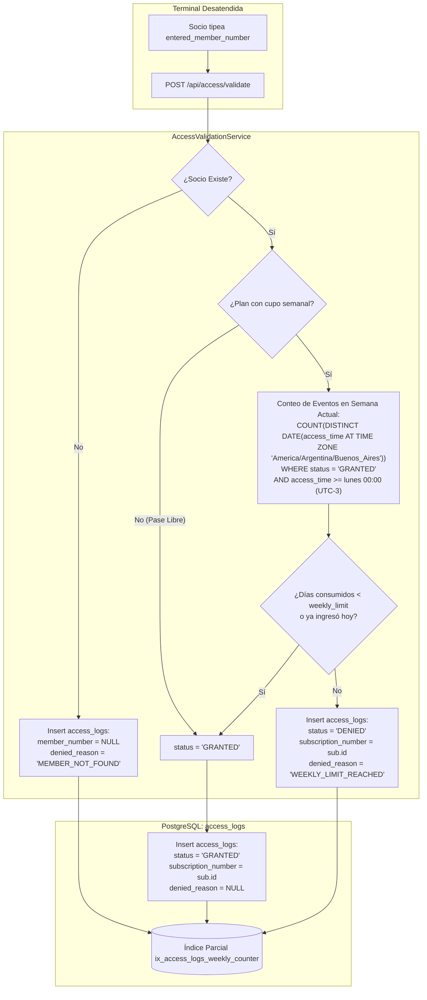

# ADR-0009: Auditoría Forense en Terminal de Acceso y Estado Derivado sin Contadores Mutantes

* **Fecha:** 2026-10-11
* **Estado:** Aceptado

## Contexto y Problema

El control de ingreso físico al gimnasio a través de terminales desatendidas y molinetes mecánicos genera un flujo continuo de solicitudes de acceso en tiempo real (`POST /api/access/validate`). Este flujo operativo demanda dos requisitos esenciales para el sistema:
1. **Auditoría Forense Integral de Intentos de Acceso:** Por motivos de seguridad física, análisis de tráfico y control de desvíos, la administración requiere registrar absolutamente todo intento de paso, tanto los autorizados como los rechazados. Esto incluye registrar intentos con credenciales mal digitadas o inexistentes, intentos de socios dados de baja, personas con cuota vencida o socios que han excedido su cupo semanal.
2. **Control de Cupo Semanal sin Desincronización ni Tareas Cron:** Ciertos planes comerciales limitan los ingresos semanales a una cantidad de días fija (por ejemplo, 2 o 3 días por semana según `plans.weekly_limit`). El diseño tradicional consiste en agregar una columna contadora mutable en la tabla de socios o suscripciones (`days_used_this_week`), la cual se incrementa en cada acceso y se restablece a cero todos los lunes a la medianoche mediante una tarea programada (`@Scheduled` cron).

Este enfoque tradicional presenta fallas críticas de diseño:
- Si el servidor de aplicaciones se encuentra apagado, en mantenimiento o sufriendo un corte eléctrico a las 00:00:00 del lunes, la tarea cron no se ejecuta, impidiendo el ingreso legítimo de socios la semana entrante.
- Fallos transaccionales o condiciones de carrera en la actualización de la columna contadora conducen a desincronizaciones acumuladas e irreparables entre los ingresos físicos reales y el contador persistido.
- La anulación o eliminación física de registros de acceso corrompe la capacidad forense de auditar incidentes pasados o reconstruir la afluencia en horarios pico.

## Decisión y Justificación

Se adopta una arquitectura de **Auditoría Forense Inmutable en `access_logs` y Estado Semanal Derivado mediante Eventos**, complementada con restricciones de integridad de motor:

1. **Inmutabilidad Forense Absoluta en `access_logs`:**
   - La tabla `access_logs` es estrictamente de sólo inserción (*append-only*). No se exponen endpoints de actualización (`PUT`) ni de eliminación (`DELETE`).
   - Todas las referencias hacia `members` y `subscriptions` poseen `ON DELETE RESTRICT`, garantizando que la traza forense perdure inalterable.
2. **Captura Fiel de Intentos y Reglas de Integridad:**
   - Se registra textualmente el valor tipeado en la terminal mediante `entered_member_number VARCHAR(20) NOT NULL` (`chk_access_entered`).
   - Si el número ingresado no corresponde a ningún socio registrado, la fila se persiste con `member_number = NULL` y `denied_reason = 'MEMBER_NOT_FOUND'`. La restricción declarativa `chk_access_not_found` condiciona estrictamente que `member_number` sea nulo si y solo si el motivo de rechazo es `MEMBER_NOT_FOUND`.
   - Si el acceso es concedido (`status = 'GRANTED'`), la restricción `chk_access_logic` exige que tanto `member_number` como `subscription_number` estén presentes y que `denied_reason` sea nulo.
   - En rechazos por cuota vencida (`PAYMENT_OVERDUE`) o cupo agotado (`WEEKLY_LIMIT_REACHED`), el servicio persiste también el `subscription_number` de la suscripción evaluada, congelando el contrato específico que motivó la denegación en lugar de obligar a inferirlo a posteriori por rangos de fecha ambiguos.
3. **Estado Derivado por Conteo de Días Distintos (Sin Contadores Mutantes):**
   - Se elimina por completo cualquier columna contadora como `days_used_this_week`.
   - Para verificar el límite semanal en planes con cupo (`plans.weekly_limit IS NOT NULL`), el servicio calcula en Java el inicio de la semana calendario (lunes a las 00:00:00 en zona horaria operativa `America/Argentina/Buenos_Aires`) inyectando el bean `Clock`, y consulta los días calendario distintos utilizados:
     ```sql
     SELECT COUNT(DISTINCT DATE(access_time AT TIME ZONE 'America/Argentina/Buenos_Aires'))
     FROM access_logs
     WHERE member_number = :memberNumber
       AND access_time >= :startOfWeek
       AND status = 'GRANTED';
     ```
   - Esta consulta está respaldada por el índice relacional parcial:
     ```sql
     CREATE INDEX IF NOT EXISTS ix_access_logs_weekly_counter 
     ON access_logs (member_number, access_time) 
     WHERE status = 'GRANTED';
     ```
   - Al contar días calendario distintos, se absorbe naturalmente la regla de tolerancia intradía (múltiples ingresos el mismo día cuentan como 1 solo día consumido), eliminando de raíz la necesidad de tareas de reseteo por cron de fin de semana.

### Alternativas Descartadas

* **Columna Contadora `days_used_this_week` con Reseteo por Cron los Lunes:** Descartado categóricamente. Cualquier suspensión de servicio durante la ventana de ejecución del cron rompe la consistencia del gimnasio para toda la semana. Además, actualizar concurrentemente una fila de contador genera contención y bloqueos innecesarios en la tabla de suscripciones.
* **Uso de `ON DELETE SET NULL` en `access_logs.member_number`:** Descartado. Confundiría el significado forense del modelo: un intento legítimo de un socio que posteriormente fue eliminado se transformaría erróneamente en un registro `member_number IS NULL`, desvirtuando la regla `chk_access_not_found` y falseando las estadísticas de seguridad perimetral.
* **Inferencia Dinámica de la Suscripción por Fecha en Auditoría:** Descartado. Si un socio cancela una suscripción y genera una nueva el mismo día, inferir la suscripción mediante un `JOIN` temporal sobre logs pasados introduce ambigüedad histórica. Almacenar explícitamente `subscription_number` en el momento exacto del evento congela el contrato evaluado sin margen de duda.

## Flujo Visual



## Compensaciones y Consecuencias

* **Ganancias / Beneficios:**
  * **Cero Tareas de Mantenimiento Crítico por Cron:** El cambio de semana calendario a las 00:00:00 del lunes entra en vigencia de forma automática y matemática según el cálculo de la consulta temporal, sin riesgo de fallos por caída del servidor.
  * **Auditoría Forense Inmutable:** Todos los intentos de ingreso (válidos, erróneos, denegados o anónimos) quedan registrados con sus identificadores de contrato congelados, satisfaciendo requerimientos de seguridad perimetral y métricas de concurrencia horaria.
  * **Idempotencia Intradía Natural:** El conteo sobre días distintos consolida automáticamente múltiples entradas durante una misma jornada sin requerir banderas temporales intermedias.
* **Costos / Deuda Técnica:**
  * **Cálculo de Agregación en Tiempo Real:** El molinete ejecuta una consulta agregada (`COUNT(DISTINCT ...)`) para validar el cupo semanal. No obstante, al estar acotada a una sola semana en curso y filtrada por el índice parcial `ix_access_logs_weekly_counter (member_number, access_time) WHERE status = 'GRANTED'`, la consulta recorre a lo sumo un puñado de filas indexadas, respondiendo en sub-milisegundos.
  * **Crecimiento Continuo de la Tabla `access_logs`:** Al no borrarse ningún registro de acceso, la tabla crece monótonamente en el tiempo. Para escalas de gimnasio de miles de accesos mensuales esto no presenta inconvenientes inmediatos, pero a largo plazo (plazos de varios años) requerirá políticas de particionado por rangos de fecha en base de datos.
