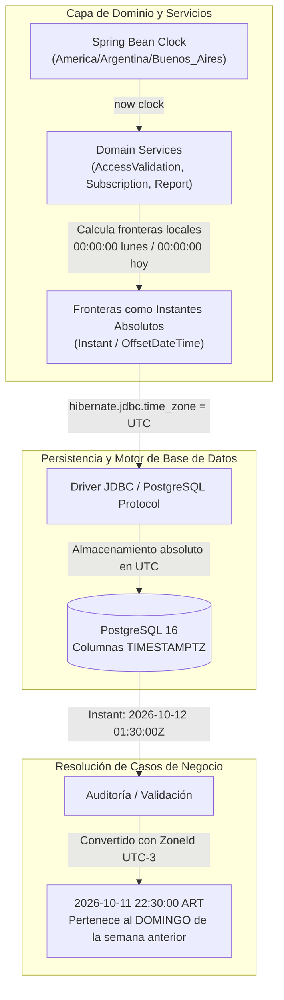

# ADR-0010: Tratamiento Temporal Universal con TIMESTAMPTZ, Huso Horario Operativo Local (UTC-3) y Desacoplamiento mediante Bean Clock

* **Fecha:** 2026-10-11
* **Estado:** Aceptado

## Contexto y Problema

Los entornos de ejecución modernos (contenedores Docker, servidores de aplicaciones Java y bases de datos gestionadas en la nube) ejecutan y configuran sus sistemas operativos y motores relacionales de manera predeterminada en el tiempo universal coordinado (`UTC`). En contraste, la operación física y comercial de Gym Manager se localiza íntegramente en la República Argentina, bajo el huso horario oficial `America/Argentina/Buenos_Aires` (`UTC-3` sin horario de verano vigente).

Esta discrepancia horaria introduce severas tensiones en la evaluación de reglas de negocio que dependen de límites de calendario:
1. **Límites semanales y reseteo de cupos:** Un socio que ingresa un domingo a las 22:30 hora local genera un evento cuya marca temporal en UTC es el lunes a las 01:30. Si la consulta de auditoría o el cálculo de cupo semanal agrupa por semanas en UTC, dicho acceso se imputa erróneamente a la semana entrante en lugar de la que está concluyendo, consumiendo un día del nuevo ciclo.
2. **Idempotencia intradía ("la prueba del auto"):** Si un socio sale del gimnasio y reingresa el mismo día después de las 21:00 hora local (00:00 UTC del día siguiente), una comparación basada en fechas UTC considerará que el reingreso ocurre en una nueva jornada calendario, penalizando al socio con un consumo indebido de su límite semanal.
3. **Métricas de afluencia y horarios pico:** Los reportes de afluencia horaria quedarían desfasados en 3 horas respecto a la concurrencia física real en las instalaciones.
4. **Determinismo y testabilidad:** El uso directo de llamadas estáticas a `LocalDateTime.now()` o `Instant.now()` en la capa de servicios acopla el código al reloj físico del sistema operativo anfitrión, impidiendo simular cambios de turno, transiciones de medianoche del domingo o saltos de mes en pruebas unitarias e integrales sin recurrir a esperas activas o mutaciones globales del sistema.

Asimismo, según los lineamientos de saneamiento documental (Tarea 0.4), la solución no debe atarse a nombres de proveedores comerciales específicos de infraestructura, sino formularse en términos de estándares temporales universales y desacoplamiento de software.

## Decisión y Justificación

Se adopta una arquitectura temporal de tres niveles basada en almacenamiento en instantes absolutos UTC, cómputo de reglas en huso operativo local y desacoplamiento del reloj de ejecución:

1. **Persistencia física universal en `TIMESTAMPTZ` con JDBC en UTC:**
   - Todas las columnas de marcas temporales en PostgreSQL (`created_at`, `updated_at`, `join_date`, `start_date`, `end_date`, `access_time`) se declaran de forma estricta como `TIMESTAMPTZ` (`timestamp with time zone`).
   - El motor almacena internamente cada valor normalizado como un instante absoluto universal en UTC.
   - La conexión JDBC de la aplicación Spring Boot se configura con la propiedad `hibernate.jdbc.time_zone: UTC`, asegurando que toda serialización y deserialización entre entidades Java (`java.time.Instant` u `OffsetDateTime`) y PostgreSQL mantenga coherencia exacta de época Unix.
   - Las fechas puras de calendario sin componente horaria (específicamente `persons.birth_date`) se preservan como tipo SQL `DATE` y se mapean a `java.time.LocalDate`, evitando traslaciones erróneas de día por conversión horaria.

2. **Evaluación de fronteras operativas en `America/Argentina/Buenos_Aires` (`UTC-3`):**
   - Todas las reglas comerciales (cálculo de inicio de semana los lunes a las 00:00:00, inicio del día a las 00:00:00 para tolerancia intradía, vigencia de períodos de suscripción con fin exclusivo `[)`) se calculan formalmente en la zona horaria del gimnasio utilizando `ZoneId.of("America/Argentina/Buenos_Aires")`.
   - La capa de aplicación es la responsable de calcular los instantes de inicio (`from`) y fin (`to`) del período en hora local, transformarlos a instantes universales y pasarlos parametrizados a las consultas SQL/JPA, evitando delegar la lógica de negocio temporal a funciones de base de datos dependientes de la configuración del servidor.

3. **Inyección de dependencia mediante Bean `java.time.Clock`:**
   - Se declara en el contexto de Spring un Bean de tipo `java.time.Clock` configurado por defecto como `Clock.system(ZoneId.of("America/Argentina/Buenos_Aires"))`.
   - Se inyecta este Bean en todos los servicios de dominio que manipulan tiempo (`SubscriptionService`, `AccessValidationService`, `ReportService`, `CommunicationService`).
   - Queda terminantemente prohibida la invocación directa de métodos estáticos sin reloj (`LocalDateTime.now()`, `OffsetDateTime.now()`, `Instant.now()`). Toda obtención de la hora actual debe realizarse a través de `Instant.now(clock)` o `ZonedDateTime.now(clock)`.
   - En suites de pruebas unitarias y de integración, se sustituye el bean por `Clock.fixed(instant, zone)` para congelar el tiempo en escenarios críticos de borde (ej. domingo 23:59:59, lunes 00:00:01, saltos de mes bisiesto).

### Alternativas Descartadas

* **Uso de tipo SQL `TIMESTAMP` (sin zona horaria):** Descartado porque almacena la fecha y hora omitiendo el desfase horario. Si el contenedor backend corre en UTC y la base almacena sin zona, los valores quedan corrompidos o sujetos a la zona del cliente que emita la consulta, generando desfases de 3 horas en la vigencia contractual y en el cálculo de auditoría.
* **Invocaciones estáticas a `LocalDateTime.now()` y `OffsetDateTime.now()` en servicios:** Descartado porque introduce un acoplamiento directo al reloj del hardware, imposibilitando escribir pruebas deterministas para límites temporales (medianoche del domingo, solapamientos, vencimientos) sin depender de manipulaciones invasivas del entorno de ejecución.
* **Cálculo ad-hoc de husos horarios en los clientes de Frontend:** Descartado porque delegar el cálculo de períodos de suscripción o reseteo de cupos a la terminal o al navegador web del usuario vulnera la seguridad del negocio; las reglas de facturación, acceso y auditoría deben regirse soberanamente en el backend con una única fuente de tiempo confiable.

## Flujo Visual

## Compensaciones y Consecuencias

* **Ganancias / Beneficios:**
  * **Invarianza de infraestructura:** El sistema opera idénticamente en entornos de desarrollo locales, contenedores Docker y servidores de base de datos en la nube sin importar la configuración de zona horaria del host anfitrión.
  * **Trazabilidad y auditoría exacta:** Cada intento de acceso y cada cobro se registra con precisión de milisegundos respecto a la línea de tiempo global, garantizando que el orden cronológico absoluto de `access_logs` y `payments` sea irrefutable.
  * **Testabilidad determinista completa:** Capacidad de simular cualquier escenario temporal arbitrario (ej. transiciones de semana en planes de 3 días) inyectando `Clock.fixed(...)` en las pruebas de software.
  * **Eliminación de anomalías de cupo:** Se garantiza que un socio que accede tarde los días de fin de semana no sufra cobros de cupo en la semana siguiente ni se bloquee indebidamente su reingreso en el mismo día.

* **Costos / Deuda Técnica:**
  * **Disciplina de desarrollo obligatoria:** Requiere velar en revisiones de código que ningún desarrollador invoque `now()` sin pasar la instancia inyectada de `Clock`.
  * **Conversión explícita de zonas:** Mayor verbosidad en los repositorios y servicios al tener que transformar rangos locales (ej. `LocalDate.atStartOfDay(zone)`) a `Instant` antes de despachar parámetros de consulta SQL.
