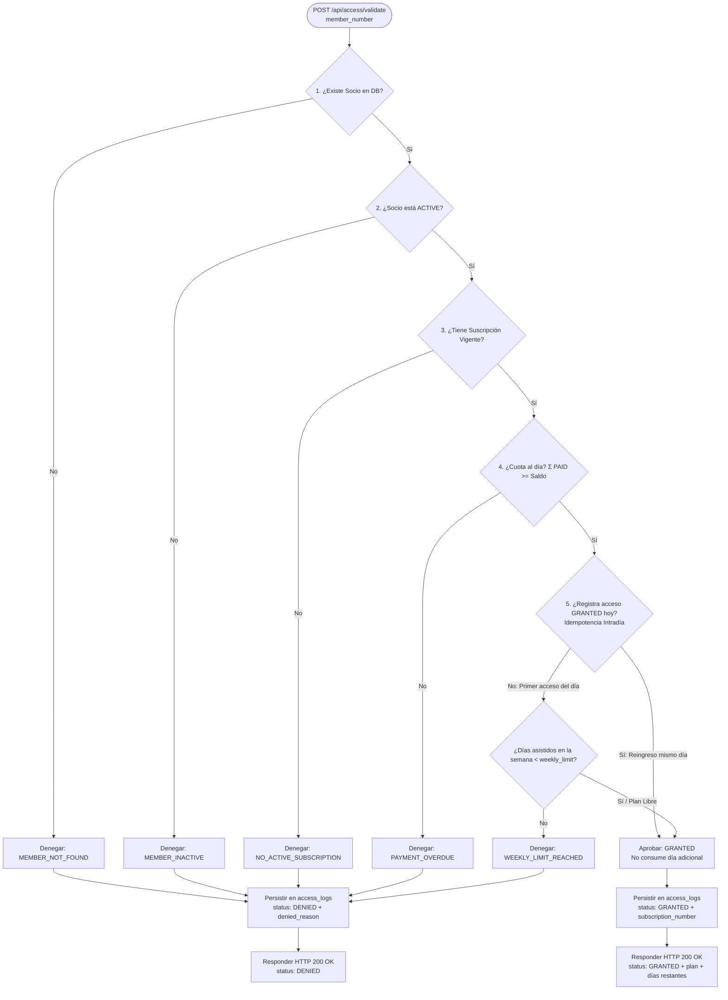

# ADR-0011: Patrón Chain of Responsibility para Validación de Accesos en Tiempo Real con Idempotencia Intradía

* **Fecha:** 2026-10-11
* **Estado:** Aceptado

## Contexto y Problema

El endpoint `POST /api/access/validate` (RF-20) constituye la operación de negocio más crítica y sensible al rendimiento en la terminal de acceso físico (molinete o kiosco desatendido). Ante cada intento de ingreso en el que se tipea un número de socio o se escanea una credencial, el backend debe evaluar de forma inmediata y en tiempo real un conjunto exhaustivo de reglas de negocio para conceder o denegar el paso.

El proceso está condicionado por los siguientes requisitos y restricciones de dominio:
1. **Orden de precedencia estricto y cortocircuito:** Existen 5 causas posibles de denegación (`MEMBER_NOT_FOUND`, `MEMBER_INACTIVE`, `NO_ACTIVE_SUBSCRIPTION`, `PAYMENT_OVERDUE`, `WEEKLY_LIMIT_REACHED`). La evaluación debe detenerse inmediatamente ante la primera falla detectada para no ejecutar consultas innecesarias ni reportar motivos inconsistentes (por ejemplo, no se debe verificar el pago de una suscripción si el socio no existe o está dado de baja).
2. **Idempotencia intradía ("la prueba del auto"):** En los planes que imponen un cupo semanal de días permitidos (ej. planes de 3 días semanales), si un socio ingresa al gimnasio a las 09:00, sale transitoriamente a las 10:00 (por ejemplo, a buscar pertenencias a su vehículo) y reingresa a las 10:15 del mismo día, el segundo acceso no debe consumir un día adicional de su cupo semanal disponible.
3. **Auditoría forense completa e incondicional:** Todo intento de acceso, ya sea concedido (`GRANTED`) o denegado (`DENIED`), debe persistirse de forma inmutable en la tabla `access_logs`, asociando la suscripción que lo habilitó o la razón de denegación exacta.
4. **Respuesta HTTP semántica uniforme:** La terminal espera recibir invariablemente un código de estado `200 OK` con un cuerpo JSON que detalle el resultado (`status: GRANTED` o `status: DENIED`) y, de corresponder, la razón de rechazo (`denied_reason`), el nombre del socio, plan vigente y días restantes en la semana. Solo los errores catastróficos de infraestructura devuelven errores `5xx`.
5. **Concurrencia en horas pico:** En momentos de alta afluencia física (entradas y salidas simultáneas en recepción), el mecanismo de validación no puede recurrir a bloqueos pesimistas extensos sobre la tabla de socios o suscripciones que generen cuellos de botella o interbloqueos (*deadlocks*).

## Decisión y Justificación

Se adopta el patrón de diseño **GoF Chain of Responsibility** para estructurar la canalización de validaciones de acceso en eslabones desacoplados, implementando además tolerancia intradía y concurrencia optimista:

1. **Modelado mediante Chain of Responsibility (`AccessRuleValidator`):**
   - Se define una interfaz de eslabón `AccessRuleValidator` con un método `ValidationResult validate(AccessValidationContext context)`.
   - Se instancian y enlazan en memoria los siguientes eslabones en estricto orden de precedencia:
     1. **`MemberExistsValidator`:** Verifica la existencia de `member_number` en el repositorio de socios. Si no existe, corta la cadena y retorna denegación con motivo `MEMBER_NOT_FOUND`.
     2. **`MemberActiveValidator`:** Verifica que `members.status == 'ACTIVE'`. Si está inactivo, corta la cadena y retorna `MEMBER_INACTIVE`.
     3. **`ActiveSubscriptionValidator`:** Verifica que el socio posea al menos una suscripción vigente en el instante actual (`start_date <= now < end_date`) y con estado `status == 'ACTIVE'`. Si no existe, corta y retorna `NO_ACTIVE_SUBSCRIPTION`.
     4. **`PaymentUpToDateValidator`:** Verifica el estado financiero de la suscripción vigente mediante la suma contable del ledger de cobros: $\sum \text{amount}_{\text{PAID}} \ge (\text{price} - \text{discount})$. Si existe saldo deudor impago, corta y retorna `PAYMENT_OVERDUE`.
     5. **`WeeklyQuotaAndIntradayReentryValidator`:** Evalúa el cupo semanal según el plan contratado (`plans.weekly_limit`).
   - Si la solicitud supera exitosamente todos los eslabones sin corte, la cadena produce el resultado final `AccessResult.granted(subscription)`.

2. **Mecanismo de Idempotencia Intradía:**
   - Dentro del eslabón `WeeklyQuotaAndIntradayReentryValidator`, se ejecuta una consulta sobre `access_logs` verificando si el socio ya registra un acceso previo concedido (`status = 'GRANTED'`) en el día calendario en curso (desde las `00:00:00` en huso `America/Argentina/Buenos_Aires`).
   - Si ya existe un ingreso exitoso hoy, el acceso se aprueba de inmediato (`GRANTED`) sin evaluar el cupo semanal restante, satisfaciendo formalmente "la prueba del auto" y garantizando que las reentradas intradía no consuman días de la cuota.
   - Si es el primer ingreso del día y el plan tiene límite semanal (`weekly_limit IS NOT NULL`), se calcula la cantidad de días distintos ya asistidos en la semana mediante `COUNT(DISTINCT DATE(access_time AT TIME ZONE 'America/Argentina/Buenos_Aires'))`. Si dicha cuenta es menor a `weekly_limit`, se aprueba; de lo contrario, se corta la cadena con `WEEKLY_LIMIT_REACHED`.

3. **Transacciones cortas sin bloqueo pesimista:**
   - La validación y la inserción subsiguiente en `access_logs` se ejecutan dentro de una transacción corta de base de datos sin aplicar `SELECT ... FOR UPDATE` sobre la fila del socio.
   - En el caso improbable de un escaneo simultáneo en el mismo instante, la idempotencia intradía absorbe la condición de carrera: si dos solicitudes concurrentes del mismo socio resultan aprobadas en el mismo día, ambas generarán filas `GRANTED` para la misma fecha local, pero la consulta de cupo semanal utiliza `COUNT(DISTINCT ...)`, computando ambos ingresos como un único día utilizado.

4. **Persistencia incondicional en `access_logs` y retorno HTTP:**
   - Tras obtener el resultado de la cadena (ya sea `GRANTED` o `DENIED`), el servicio registra obligatoriamente la fila en `access_logs` cumpliendo con las restricciones `chk_access_logic`, `chk_access_denied_reason` y `chk_access_not_found`.
   - Se retorna invariablemente un estado HTTP `200 OK` a la terminal con la estructura DTO acordada.

### Alternativas Descartadas

* **Método monolítico con condicionales `if-else` anidados en `AccessService`:** Descartado porque acumula responsabilidades divergentes en un único método de gran tamaño, dificulta escribir pruebas unitarias aisladas para cada regla de negocio y viola el principio Abierto/Cerrado (Open/Closed Principle) al requerir modificar el método ante cualquier ajuste de políticas comerciales.
* **Columna contadora decremental con descuento en cada ingreso:** Descartado porque fallaría de forma inmediata en la "prueba del auto" (descontando saldo de días ante cada salida transitoria) y requeriría una tarea programada (*cron job*) compleja y propensa a fallas para reiniciar contadores todos los lunes a las 00:00.
* **Bloqueo pesimista (`SELECT ... FOR UPDATE`) sobre la fila de `members` durante la validación:** Descartado porque introduce contención innecesaria y serialización forzada de transacciones en la terminal física de acceso en horarios pico, degradando la latencia de respuesta en una operación que exige tiempos de respuesta sub-segundo en molinete.

## Flujo Visual

## Compensaciones y Consecuencias

* **Ganancias / Beneficios:**
  * **Alta cohesión y desacoplamiento:** Cada regla de validación está encapsulada en una clase independiente con su propia responsabilidad, facilitando la incorporación de nuevas reglas o la modificación de las existentes sin tocar el resto de la cadena.
  * **Excelente rendimiento y latencia reducida:** El cortocircuito inmediato detiene el procesamiento en el primer eslabón insatisfecho, optimizando el consumo de I/O de base de datos.
  * **Experiencia de usuario fluida y justa:** La idempotencia intradía resuelve nativamente el caso de uso real de salidas y reingresos temporales sin necesidad de intervenciones manuales por parte del personal de recepción.
  * **Auditoría forense robusta:** Cada intento de acceso (válido o inválido) queda registrado con el motivo exacto y marca temporal de alta fidelidad, permitiendo reportes de afluencia fidedignos y detección de fraudes.

* **Costos / Deuda Técnica:**
  * **Mayor número de clases de soporte:** La introducción de interfaces, contexto de validación y eslabones concretos eleva el conteo de archivos en la capa de servicios respecto a un enfoque procedural simple.
  * **Sensibilidad al orden de configuración:** La cadena depende de que los eslabones se ensamblen en el orden de precedencia exacto definido por el negocio; una inversión accidental en el orden (ej. validar pago antes de suscripción) causaría excepciones en tiempo de ejecución.
