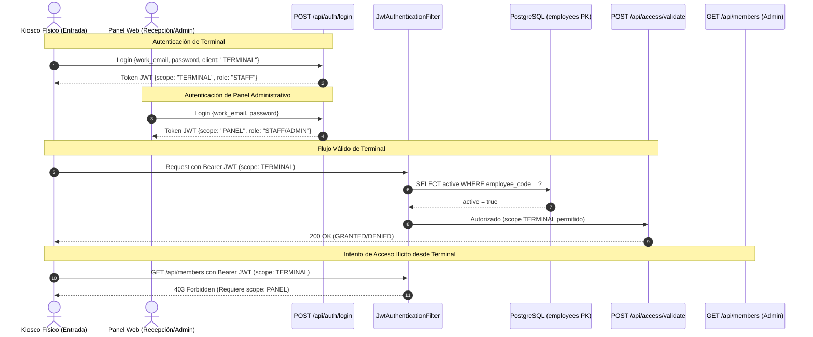

# ADR-0012: Autenticación Stateless con JWT y Segregación de Alcance Dual (PANEL vs. TERMINAL)

* **Fecha:** 2026-10-11
* **Estado:** Aceptado

## Contexto y Problema

El ecosistema de Gym Manager interactúa con dos interfaces frontend web independientes que consumen la misma API REST del backend:
1. **El Panel Administrativo (`gym-frontend-admin`):** Utilizado por personal administrativo (`ADMIN`) y de recepción (`STAFF`) para la gestión integral de socios, cobros de cuotas, planes y métricas operativas.
2. **La Terminal de Acceso Físico (`gym-frontend-access`):** Kiosco o pantalla ubicada en la entrada física del gimnasio (junto al molinete), operando en modo desatendido o semi-desatendido con una sesión permanente de usuario `STAFF` para procesar el ingreso de socios mediante `POST /api/access/validate` (RF-20).

Esta coexistencia plantea dos riesgos de seguridad de primer orden:
* **Exposición física del Kiosco de Entrada:** Al encontrarse en un área de circulación pública, si un atacante accede físicamente a las herramientas de desarrollo o al almacenamiento del navegador en la terminal y extrae el token de autenticación de la sesión abierta, no debe bajo ninguna circunstancia poder consumir la API administrativa para listar socios, consultar DNIs, modificar planes o registrar cobros fraudulentos.
* **Revocación inmediata de personal desvinculado:** Si un empleado es despedido o revocado en el sistema (`employees.active = false`), su capacidad para operar o ingresar al sistema debe anularse en tiempo real, sin requerir esperar a la expiración natural del token.

Adicionalmente, la arquitectura busca mantener un modelo de despliegue liviano, sin añadir servidores dedicados de caché en memoria (como Redis) ni estado de sesión en memoria del servidor web, asegurando escalabilidad horizontal y simplicidad de mantenimiento.

## Decisión y Justificación

Se adopta un esquema de autenticación sin estado (*stateless*) basado en tokens **JSON Web Token (JWT)** firmados con `HMAC-SHA256`, complementado con **segregación estricta de alcance dual (`scope`)** y **verificación de activación por clave primaria en cada solicitud**:

1. **Estructura y firma del JWT:**
   - Todo inicio de sesión mediante `POST /api/auth/login` (RF-01) verifica las credenciales de `employees` (con correo institucional evaluado de forma insensible a mayúsculas mediante `LOWER(work_email)` y contraseña validada con BCrypt).
   - El token emitido se firma criptográficamente con algoritmo `HMAC-SHA256` utilizando una clave secreta robusta provista por variable de entorno del sistema (`JWT_SECRET`).
   - El payload del token contiene los claims estándar y de dominio:
     - `sub`: Correo electrónico institucional (`work_email`).
     - `role`: Rol del empleado (`ADMIN` o `STAFF`).
     - `employeeCode`: Identificador operativo (`employee_code`).
     - `scope`: Alcance de autorización (`PANEL` o `TERMINAL`).
     - `iat` y `exp`: Instantes de emisión y expiración (tiempo de vida acotado).

2. **Segregación de Alcance Dual (`scope: PANEL` vs. `scope: TERMINAL`):**
   - El payload del endpoint de login recibe un atributo opcional `client` indicando el ámbito del cliente solicitante (`TERMINAL` o `PANEL`, siendo `PANEL` el valor por defecto cuando no se especifica).
   - Si se autentica la terminal de acceso (`client = TERMINAL`), el backend emite un token con claim `scope: TERMINAL`.
   - **Límite de autorización estricto:** El alcance `scope: TERMINAL` está habilitado **exclusivamente** para consumir `POST /api/access/validate` (RF-20). Cualquier intento de consumir endpoints administrativos, de gestión de socios, cobros, o reportes con un token `TERMINAL` es rechazado de forma tajante con código HTTP `403 Forbidden`.
   - Si se autentica el panel administrativo (sin campo `client` o con `client = PANEL`), se emite un token con claim `scope: PANEL`, el cual permite acceder a los módulos administrativos de acuerdo al rol del empleado (`ADMIN` o `STAFF`).

3. **Verificación inmediata de revocación en `JwtAuthenticationFilter`:**
   - Para resolver el problema de la revocación en arquitecturas JWT puras sin introducir infraestructura compleja (Redis), el filtro de seguridad de Spring (`JwtAuthenticationFilter`) ejecuta en cada petición autenticada una consulta ultra-liviana por clave primaria sobre la tabla `employees`: `SELECT active FROM employees WHERE employee_code = ?`.
   - Gracias al índice de clave primaria sobre `employee_code`, la consulta se resuelve en fracciones de microsegundo en memoria de PostgreSQL sin afectar el rendimiento global.
   - Si el empleado tiene `active = false`, la petición se rechaza de inmediato con código HTTP `401 Unauthorized`, revocando el acceso en el acto sin importar que la firma o el tiempo del JWT continúen formalmente vigentes.

4. **Compensación de almacenamiento en frontend (SPAs):**
   - Se documenta la decisión consciente de almacenar el token en el almacenamiento local del navegador (`localStorage` o `sessionStorage`) de las aplicaciones frontend SPA.
   - El riesgo residual de filtración se mitiga mediante políticas estrictas de encabezados de seguridad (Content Security Policy - CSP), sanitización completa en el renderizado para evitar Cross-Site Scripting (XSS), y el confinamiento del alcance del token (`scope: TERMINAL`) en la máquina del kiosco físico.

### Alternativas Descartadas

* **Token JWT compartido sin diferenciación de alcance (`scope`):** Descartado porque si un intruso extrae el token en el kiosco de recepción, obtiene credenciales completas de `STAFF`, pudiendo consultar el padrón de socios con DNIs, teléfonos, domicilios y saldos contables, violando gravemente la privacidad de los usuarios.
* **JWT puramente sin estado sin verificación de estado en base de datos:** Descartado porque si se desvincula a un empleado con conflicto laboral, este conservaría acceso pleno al sistema administrativo hasta que su token expire, lo que representa un riesgo de seguridad y sabotaje inaceptable para la organización.
* **Uso de lista negra (*blocklist*) en cluster Redis o almacenamiento en memoria:** Descartado para la fase actual por representar sobreingeniería y sumar costos de infraestructura y puntos únicos de falla; la consulta por clave primaria en PostgreSQL cubre con creces los requerimientos de latencia y volumen del sistema.
* **Sesiones de servidor HTTP clásicas con cookies con estado:** Descartado porque rompe la arquitectura stateless de la API REST, dificulta el consumo homogéneo desde distintas plataformas clientes y requiere afinidad de sesiones o persistencia centralizada en balanceadores de carga.
* **Firma asimétrica (RS256/ES256) en lugar de secreto compartido:** Descartada para la fase actual. Existe un único emisor y un único verificador (el mismo backend), por lo que la clave pública/privada no aporta separación de responsabilidades y agrega gestión de pares de claves. Se adopta `HMAC-SHA256` con secreto compartido leído de variable de entorno; el alcance (`scope`) forma parte de la firma y no puede alterarse sin invalidarla.
* **Vigencia corta del token como único mecanismo de revocación:** Descartada porque obliga a reautenticar con frecuencia al personal de recepción y, aun así, deja una ventana de acceso tras desactivar a un empleado. La lectura por clave primaria en cada request cierra esa ventana de inmediato.

## Flujo Visual

## Compensaciones y Consecuencias

* **Ganancias / Beneficios:**
  * **Aislamiento de superficie de ataque:** El kiosco de acceso físico queda estrictamente contenido. Aunque el token del navegador sea extraído, el atacante no puede leer ni modificar ningún dato de negocio ajeno a la validación de un socio en molinete.
  * **Revocación en tiempo real:** Desactivar un empleado (`active = false`) surte efecto inmediato en la siguiente petición HTTP sin demoras de propagación.
  * **Infraestructura simplificada:** No se requiere provisionar ni mantener servicios externos como Redis o almacenes de sesiones en clúster.
  * **Arquitectura REST pura:** Las peticiones HTTP son autocontenidas y transportan toda su información de contexto de seguridad.

* **Costos / Deuda Técnica:**
  * **Consulta a base de datos en cada petición:** Se introduce un `SELECT` por clave primaria en el filtro de seguridad para cada request autenticado. Dado el índice primario en `employee_code` y la escala del gimnasio, el impacto en latencia es menor a 1 milisegundo.
  * **Almacenamiento del token en Web Storage del cliente:** El almacenamiento en `localStorage`/`sessionStorage` expone el token a ataques si existiese una vulnerabilidad de XSS en las vistas web, requiriendo defensas estrictas en la compilación y renderizado de componentes frontend.
