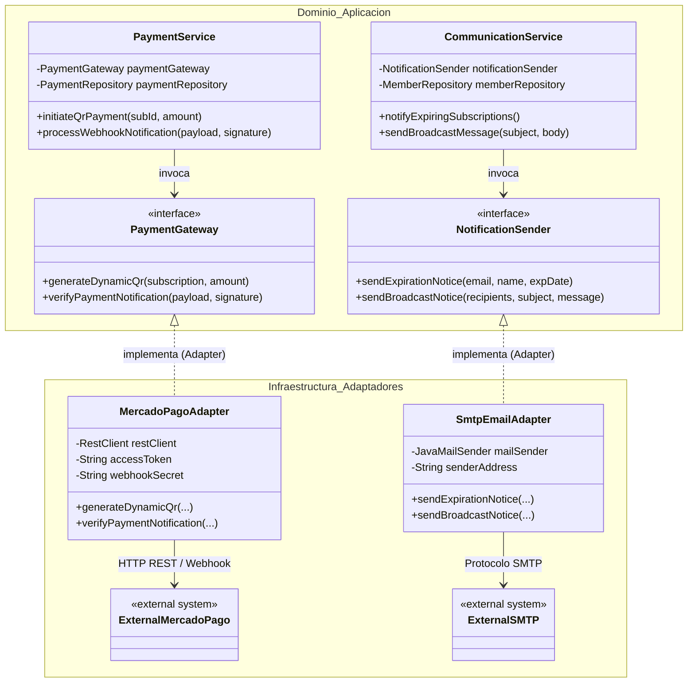

# ADR-0013: Desacoplamiento de Servicios Externos mediante Patrón Adapter (Mercado Pago y Notificaciones de Correo)

* **Fecha:** 2026-10-11
* **Estado:** Aceptado

## Contexto y Problema

El dominio de negocio de Gym Manager requiere interactuar con servicios y plataformas externas de terceros para completar operaciones clave:
1. **Cobros Digitales y Conciliación (RF-18, RF-19):** Generación de órdenes de pago con código QR interoperable y recepción de notificaciones asíncronas vía Webhooks mediante la pasarela de pagos de Mercado Pago.
2. **Comunicaciones y Notificaciones (RF-31, RF-32):** Envío masivo de avisos institucionales y recordatorios de vencimiento de suscripción a socios mediante servidores de correo electrónico saliente vía protocolo SMTP.

La integración con estos proveedores presenta desafíos y riesgos arquitectónicos significativos:
* **Acoplamiento tecnológico al proveedor:** El uso directo de SDKs propietarios o librerías específicas (como el SDK oficial de Mercado Pago o `JavaMailSender` de Spring) en las clases de servicio del dominio (`PaymentService`, `CommunicationService`) acopla la lógica de negocio a los contratos, clases y modelos de datos del proveedor externo. Cualquier cambio de API o reemplazo de proveedor forzaría la reescritura del código de negocio.
* **Agotamiento del pool de conexiones de base de datos:** Si una llamada de red externa hacia la pasarela de pagos o el servidor SMTP se ejecuta dentro de un método anotado con `@Transactional`, la conexión JDBC de base de datos permanece retenida durante toda la duración del I/O de red. Ante latencias elevadas o indisponibilidad del servicio externo, el pool de conexiones (HikariCP) se agota velozmente, colapsando el backend por completo.
* **Dificultad en pruebas automatizadas:** Invocar APIs reales de terceros en suites de prueba unitaria o de integración genera lentitud, costos, fallas intermitentes y dependencia de conectividad a internet.

## Decisión y Justificación

Se adopta el patrón estructural **GoF Adapter** (en conjunción con el principio de Inversión de Dependencias y la arquitectura de Puertos y Adaptadores / Arquitectura Hexagonal) para aislar por completo la capa de dominio de las implementaciones de infraestructura externa:

1. **Definición de Puertos de Dominio (Interfaces):**
   - El dominio declara sus propias interfaces de abstracción (*Ports*), expresadas en términos del lenguaje ubicuo del gimnasio:
     - `PaymentGateway`: Define contratos como `QrPaymentOrder generateDynamicQr(Subscription subscription, BigDecimal amount)` y `PaymentVerification verifyPaymentNotification(String notificationPayload, String signature)`.
     - `NotificationSender`: Define contratos como `void sendExpirationNotice(String recipientEmail, String memberName, LocalDate expirationDate)` y `NotificationBatchResult sendBroadcastNotice(List<String> recipients, String subject, String message)`.
   - Estas interfaces pertenecen exclusivamente al paquete de dominio o aplicación y no hacen referencia a ninguna clase o DTO de Mercado Pago o JavaMail.

2. **Implementación de Adaptadores de Infraestructura (*Adapters*):**
   - En la capa de infraestructura se desarrollan los adaptadores concretos que implementan los puertos del dominio:
     - `MercadoPagoAdapter implements PaymentGateway`: Encapsula la comunicación HTTP con la API de Mercado Pago, la generación del QR, la validación de firmas criptográficas HMAC del webhook y la transformación de DTOs externos a entidades y registros del dominio.
     - `SmtpEmailAdapter implements NotificationSender`: Encapsula la configuración de `JavaMailSender`, la construcción de mensajes MIME multipartes, y el manejo de reintentos y capturas de excepciones SMTP.
   - La inyección de dependencias de Spring se encarga de proveer las implementaciones concretas a los servicios de dominio correspondientes (`PaymentService`, `CommunicationService`).

3. **Ejecución obligatoria fuera de transacciones de base de datos:**
   - Se establece como invariante arquitectónica que **ninguna invocación a métodos de `PaymentGateway` o `NotificationSender` puede ejecutarse dentro de un bloque `@Transactional` de base de datos**.
   - Los servicios organizan su flujo separando estrictamente las fases:
     1. Obtención o validación previa de datos (transacción de lectura corta).
     2. Llamada de red al adaptador externo (I/O de red sin conexión JDBC abierta).
     3. Persistencia atómica del resultado en `payments` o actualización de estado (transacción de escritura corta).

4. **Tolerancia a fallos y manejo individual en envíos masivos:**
   - En el envío masivo de correos (RF-31), el adaptador `SmtpEmailAdapter` procesa los envíos de forma individual o en lotes desacoplados capturando excepciones por destinatario, de modo que una dirección inválida o un rechazo SMTP transitorio no interrumpa el procesamiento para el resto de los socios.

5. **Inyección de credenciales mediante variables de entorno:**
   - Todas las credenciales, llaves de API y tokens de acceso (`MERCADO_PAGO_ACCESS_TOKEN`, `MERCADO_PAGO_WEBHOOK_SECRET`, `SPRING_MAIL_HOST`, `SPRING_MAIL_USERNAME`, `SPRING_MAIL_PASSWORD`) se inyectan dinámicamente mediante variables de entorno en el arranque del sistema, sin exponer secretos en archivos de código fuente.

### Alternativas Descartadas

* **Invocación directa de librerías y SDKs en los servicios de negocio (`PaymentService` con SDK de Mercado Pago):** Descartada porque acopla fuertemente el núcleo del sistema a las versiones del proveedor y bloquea transacciones de base de datos durante retardos de red, exponiendo al sistema a saturación de recursos e impidiendo probar la lógica de cobro con dobles de prueba simples (*mocks* o *stubs*).
* **Adopción de un motor de mensajería asíncrona dedicado (RabbitMQ, Kafka o AWS SQS):** Descartada para la fase actual del proyecto por introducir una complejidad operativa desproporcionada para el volumen de transacciones de un gimnasio mediano, agregando componentes de infraestructura adicionales a monitorear y mantener.
* **Procesamiento de pagos sincrónico exclusivo en efectivo sin integración a pasarelas:** Descartada porque incumple los requerimientos funcionales del negocio (RF-18 y RF-19), los cuales exigen soporte nativo para cobros digitales mediante código QR y conciliación automática en mostrador.

## Flujo Visual

## Compensaciones y Consecuencias

* **Ganancias / Beneficios:**
  * **Inversión de dependencias y código limpio:** El dominio se mantiene libre de detalles tecnológicos de terceros, facilitando su comprensión, auditoría y evolución a largo plazo.
  * **Testabilidad ágil y determinista:** Permite escribir pruebas unitarias exhaustivas para `PaymentService` y `CommunicationService` utilizando implementaciones simuladas (*fakes* o *mocks*) sin requerir credenciales reales ni conexión a internet.
  * **Resiliencia de conexiones de base de datos:** Al desacoplar las llamadas de red externas de los bloques transaccionales `@Transactional`, el pool HikariCP queda protegido contra agotamientos causados por latencia de proveedores.
  * **Flexibilidad comercial:** Reemplazar o incorporar otra pasarela de pago o proveedor de correo requiere únicamente crear una nueva clase adaptadora sin tocar una sola línea de la lógica de negocio existente.

* **Costos / Deuda Técnica:**
  * **Capa adicional de indirección:** Obliga a mapear DTOs entre el modelo del proveedor externo y las representaciones internas del dominio, introduciendo código de conversión adicional.
  * **Gestión manual de transacciones compuestas:** Requiere disciplina arquitectónica para asegurar que fallas en la red ocurridas luego de una operación parcial se manejen mediante compensaciones o conciliaciones posteriores (abordadas en ADRs de conciliación de pagos).
