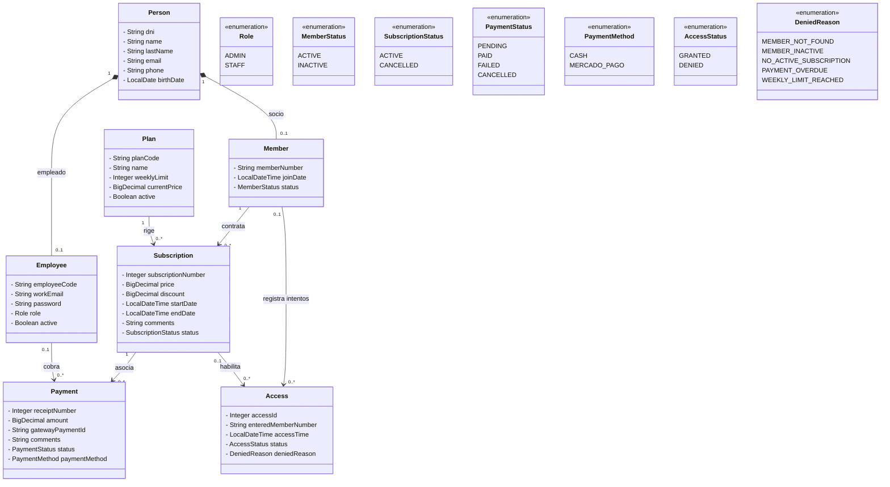

# Modelo de Datos del Dominio (Conceptual y Relacional)

Documentación técnica del modelo de datos del sistema, estructurada en dos niveles de abstracción:
1. **Modelo Conceptual de Dominio (UML):** Representación orientada a objetos de las clases de negocio, sus relaciones y atributos sin detalles de persistencia relacional.
2. **Modelo Relacional (DER):** Esquema físico en base de datos PostgreSQL, especificando tablas, claves primarias/foráneas, tipos de datos y restricciones.

---

## 1. Modelo Conceptual de Dominio (UML)

Diagrama de clases formal del dominio siguiendo las convenciones de tipos y visibilidad de Java:



### Justificación del Diseño Conceptual
* **Socio y empleado como roles de una persona:** `Person` guarda los datos de cualquier persona y `Member` y `Employee` son roles que puede tener o no. Una persona puede tener uno, el otro o los dos, por ejemplo la profe que también entrena en el gimnasio, y puede sumar o dejar un rol con el tiempo sin dejar de ser la misma persona. Por eso no se usa herencia: la herencia es fija y un cambio de rol obligaría a cambiar de clase. Se dibuja como composición porque el rol se crea para una persona y no existe sin ella.
* **Seguridad y Privacidad:** Las credenciales de autenticación quedan estrictamente contenidas en `Employee`. `Member` solo expone atributos de membresía deportiva (`memberNumber`, `joinDate`, `status`).
* **Relaciones como líneas, no como atributos:** `Subscription` no lleva `memberNumber` ni `planCode` porque a qué socio y a qué plan pertenece ya lo muestran las líneas `contrata` y `rige`. Las claves foráneas y las fechas de registro (`created_at`, `updated_at`) son detalles de las tablas y aparecen en el DER.
* **Tipado:** Los atributos siguen las convenciones y tipos estándar de Java (`String`, `LocalDate`, `LocalDateTime`, tipos de enums), prescindiendo de tipos físicos de almacenamiento como `VARCHAR` o `TIMESTAMPTZ`.
* **Modelado de Enumeraciones (Tipos de Datos vs. Relaciones):** Las enumeraciones (`Role`, `MemberStatus`, `SubscriptionStatus`, `PaymentStatus`, `PaymentMethod`, `AccessStatus`, `DeniedReason`) se modelan formalmente como clasificadores con el estereotipo `<<enumeration>>`, pero sus relaciones con las clases se expresan exclusivamente como atributos tipados (ej. `- role: Role`, `- status: MemberStatus`), sin flechas de dependencia (`..>`). Una enumeración es una especialización de `DataType` (tipo por valor); trazar líneas de dependencia hacia tipos de datos es redundante (el tipo ya está declarado en la firma del atributo) y genera "ruido visual" innecesario con cruce de aristas. Se reserva el trazado de conectores para las asociaciones semánticas directas entre entidades del dominio, manteniendo el diagrama limpio, legible y sin ambigüedades.

---

## 2. Diagrama de Entidades (DER Relacional)

```mermaid
erDiagram
    persons {
        VARCHAR(15) dni PK "Identificador natural ante el Estado"
        VARCHAR(100) name "No vacío (CHECK)"
        VARCHAR(100) last_name "No vacío (CHECK)"
        VARCHAR(255) email "Canal de contacto civil/familiar (CHECK)"
        VARCHAR(20) phone "Canal contacto (CHECK), no vacío"
        DATE birth_date
        TIMESTAMPTZ created_at
        TIMESTAMPTZ updated_at
    }
    members {
        VARCHAR(20) member_number PK "Clave natural de negocio"
        VARCHAR(15) dni FK "UK, Referencia a persons(dni)"
        VARCHAR(20) status "Enum MemberStatus: ACTIVE, INACTIVE"
        TIMESTAMPTZ join_date "Fecha de afiliación"
        TIMESTAMPTZ created_at
        TIMESTAMPTZ updated_at
    }
    employees {
        VARCHAR(20) employee_code PK "Código operativo interno"
        VARCHAR(15) dni FK "UK, Referencia a persons(dni)"
        VARCHAR(255) work_email "UK case-insensitive, Credencial de login (CHECK no vacío)"
        VARCHAR(255) password "Hash BCrypt no vacío (CHECK)"
        VARCHAR(20) role "Enum Role: ADMIN, STAFF"
        BOOLEAN active
        TIMESTAMPTZ created_at
        TIMESTAMPTZ updated_at
    }
    plans {
        VARCHAR(20) plan_code PK "Código nemotécnico natural (FREE, THREE_DAYS, etc.)"
        VARCHAR(100) name "Nombre comercial del plan (CHECK no vacío)"
        INTEGER weekly_limit "Días por semana con ingreso (nullable, no negativo si se especifica)"
        DECIMAL(19,2) current_price "Arancel de lista vigente (CHECK >= 0)"
        BOOLEAN active "Disponibilidad para contratación"
        TIMESTAMPTZ created_at
        TIMESTAMPTZ updated_at
    }
    subscriptions {
        INTEGER subscription_number PK "Número correlativo de suscripción (SERIAL)"
        VARCHAR(20) member_number FK "Referencia a members"
        VARCHAR(20) plan_code FK "Referencia a plans(plan_code)"
        DECIMAL(19,2) price "Precio pactado (CHECK >= 0)"
        DECIMAL(19,2) discount "Descuento pactado (CHECK <= price)"
        TIMESTAMPTZ start_date "Inicio del período (CHECK)"
        TIMESTAMPTZ end_date "Fin del período (CHECK)"
        VARCHAR(500) comments
        VARCHAR(20) status "Enum SubscriptionStatus: ACTIVE, CANCELLED"
        TIMESTAMPTZ created_at
        TIMESTAMPTZ updated_at
    }
    payments {
        INTEGER receipt_number PK "Número de recibo correlativo de caja (SERIAL)"
        INTEGER subscription_number FK "Referencia a subscriptions(subscription_number)"
        VARCHAR(20) employee_code FK "Referencia a employees(employee_code); vacío solo en Mercado Pago"
        DECIMAL(19,2) amount "Importe cobrado en pesos (CHECK > 0)"
        VARCHAR(20) status "Enum PaymentStatus: PENDING, PAID, FAILED, CANCELLED"
        VARCHAR(50) payment_method "Enum PaymentMethod: CASH, MERCADO_PAGO"
        VARCHAR(100) gateway_payment_id UK "Id de pasarela (MP)"
        VARCHAR(500) comments
        TIMESTAMPTZ created_at
        TIMESTAMPTZ updated_at
    }
    access_logs {
        INTEGER access_id PK "Secuencial de auditoría temporal (SERIAL)"
        VARCHAR(20) entered_member_number "Número tipeado en la terminal (CHECK no vacío)"
        VARCHAR(20) member_number FK "Referencia a members; nulo si el número no existe"
        INTEGER subscription_number FK "Suscripción que habilitó el ingreso; obligatoria si es concedido"
        TIMESTAMPTZ access_time "Momento exacto del intento"
        VARCHAR(20) status "Enum AccessStatus: GRANTED, DENIED"
        VARCHAR(30) denied_reason "Enum DeniedReason; obligatorio si es denegado (CHECK)"
    }
    persons ||..|o members : "rol de socio (0..1)"
    persons ||..|o employees : "rol de empleado (0..1)"
    plans ||..o{ subscriptions : "rige (1:N)"
    members ||..o{ subscriptions : "tiene historial (1:N)"
    members |o..o{ access_logs : "registra intentos (1:N)"
    subscriptions ||..o{ payments : "tiene pagos (1:N)"
    employees |o..o{ payments : "cobra (1:N)"
    subscriptions |o..o{ access_logs : "habilita ingresos (1:N)"
```

**Notación del diagrama:** la línea punteada representa una relación no identificadora (el hijo tiene su propia clave primaria y solo referencia al padre).
## Justificación de Claves

Cada clave primaria se definió en función de cómo opera e identifica el gimnasio a cada entidad o evento en la práctica diaria. Los fundamentos técnicos y de privacidad que sustentan el descarte de identificadores universales opacos en favor de claves de negocio y correlativos se detallan en [ADR-0003](./adr/ADR-0003-estrategia-identificadores-negocio-privacidad.md).

Se distinguen dos categorías:
- **Clave natural:** El dato surge de la realidad civil o de la nomenclatura comercial preexistente y no se repite dentro de su ámbito (DNI, número de socio, legajo de empleado, código comercial de plan).
- **Clave correlativa sustituta:** Identificador numérico secuencial generado para contratos, comprobantes e intentos de acceso donde no existe un atributo natural único. Tienen significado directo para la operación cotidiana: constituyen la referencia de contrato, el recibo de cobro y el evento auditado.

| Tabla | Clave primaria | Tipo de clave | Por qué |
|-------|----------------|---------------|---------|
| `persons` | `dni` | Natural | Acredita la identidad civil del individuo ante el Estado; dato preexistente y unívoco. |
| `members` | `member_number` | Natural del negocio | Número de carnet y de acceso público que el socio utiliza en recepción y digita en la terminal de acceso. Permite resguardar el DNI en la interacción pública. |
| `employees` | `employee_code` | Natural del negocio | Código de legajo interno del personal del gimnasio. |
| `plans` | `plan_code` | Natural del negocio | Código comercial abierto del catálogo de modalidades tarifarias (por ejemplo `THREE_DAYS`, `FREE_PASS`), sujeto a la oferta del gimnasio. |
| `subscriptions` | `subscription_number` | Correlativa (sustituta) | Referencia del contrato de suscripción para su gestión operativa en mostrador. Un socio tiene múltiples suscripciones en el tiempo; la combinación de socio y fecha de inicio no alcanza como identificador unívoco, pues una suscripción cancelada y la que la reemplaza pueden coincidir en su fecha de inicio. |
| `payments` | `receipt_number` | Correlativa (sustituta) | Recibo interno correspondiente al comprobante emitido en la transacción de cobro, análogo a un talonario de caja. |
| `access_logs` | `access_id` | Correlativa (sustituta) | Identificación individual de cada intento de acceso en la terminal. El socio y la hora no alcanzan como clave, pues dos intentos sucesivos (o intentos fallidos con número de socio inexistente) pueden registrarse dentro del mismo instante. |

Los identificadores correlativos pueden presentar discontinuidades o saltos (por ejemplo, ante operaciones no completadas) y no constituyen numeración fiscal, cumpliendo un propósito estrictamente operativo y de referencia interna.
## Relaciones

| Relación | Tipo | Descripción |
|----------|------|-------------|
| `persons` ↔ `members` | `1:1` opcional, no identificadora | Una persona puede tener el rol de socio del gimnasio. |
| `persons` ↔ `employees` | `1:1` opcional, no identificadora | Una persona puede tener el rol de empleado (cajero/administrador), incluso si también es socia. |
| `plans` ↔ `subscriptions` | `1:N` (Uno a Muchos), no identificadora | Un plan o modalidad de arancel rige múltiples contrataciones de socios a lo largo del tiempo. |
| `members` ↔ `subscriptions` | `1:N` (Uno a Muchos), no identificadora | Un socio puede tener múltiples suscripciones a lo largo del tiempo (historial por período). |
| `members` ↔ `access_logs` | `1:N` (Uno a Muchos), no identificadora | Un socio puede registrar múltiples intentos de acceso (historial de accesos). La referencia es opcional: un intento con un número que no existe se guarda sin socio. |
| `subscriptions` ↔ `payments` | `1:N` (Uno a Muchos), no identificadora | Una suscripción puede registrar múltiples pagos o intentos de cobro vinculados por `subscription_number`. |
| `subscriptions` ↔ `access_logs` | `1:N` (Uno a Muchos), no identificadora | Cada ingreso concedido guarda la suscripción que lo habilitó (`subscription_number`, obligatoria si es `GRANTED`). En un rechazo es opcional: se carga si ayuda a explicarlo, por ejemplo con cuota impaga. |
| `employees` ↔ `payments` | `1:N` (Uno a Muchos), no identificadora | Un empleado puede cobrar muchos pagos en caja. El pago guarda quién lo cobró en `employee_code` (opcional). Todo cobro en el mostrador lo guarda, también si se paga con el QR de Mercado Pago; solo queda vacío en un pago de Mercado Pago que el socio hace por su cuenta, sin pasar por caja. |

---

## Tabla: `persons`

Representa los datos físicos y de contacto de cualquier individuo registrado en el sistema (socio o empleado).

**Regla de Negocio:**
Centraliza la identidad civil legal de las personas vinculadas al gimnasio. Exige registrar al menos un canal de comunicación para contacto operativo, avisos y emergencias (correo electrónico o teléfono). El correo electrónico actúa como canal de contacto civil y familiar; no es un identificador único por individuo, permitiendo que menores de edad, tutores o integrantes de un mismo grupo familiar compartan la dirección sin restricciones de registro.

**Implementación Relacional:**
La clave primaria natural legal es `dni`. La restricción `chk_person_contact` garantiza a nivel de motor la obligatoriedad de al menos un medio de contacto (`email IS NOT NULL OR phone IS NOT NULL`). Validaciones de integridad mediante restricciones `CHECK` impiden cadenas vacías o compuestas únicamente por espacios en blanco en campos obligatorios (`name`, `last_name`, `dni`, y en `email` o `phone` cuando se informan). La búsqueda y consulta sobre correos se optimiza mediante el índice no único `ix_persons_email`. La conservación histórica e integridad declarativa se respaldan en [ADR-0005](./adr/ADR-0005-conservacion-historial-integridad-declarativa.md) y la segregación de correos en [ADR-0004](./adr/ADR-0004-segregacion-semantica-correo-electronico.md).
| Columna | Tipo | Nulos | Único | Observación |
|---------|------|-------|-------|-------------|
| `dni` | VARCHAR(15) | No | Sí (PK) | Clave primaria natural legal. No puede quedar vacío (CHECK) |
| `name` | VARCHAR(100) | No | — | Nombre(s). No puede quedar vacío (CHECK) |
| `last_name` | VARCHAR(100) | No | — | Apellido(s). No puede quedar vacío (CHECK) |
| `email` | VARCHAR(255)| Sí | — | Canal de contacto principal civil/familiar. Optimizado por `ix_persons_email` (no único, permite representación familiar). Si se carga, no puede quedar vacío |
| `phone` | VARCHAR(20) | Sí | — | Canal de contacto alternativo. Si se carga, no puede quedar vacío |
| `birth_date` | DATE | Sí | — | Fecha de nacimiento |
| `created_at` | TIMESTAMPTZ | No | — | Por defecto `CURRENT_TIMESTAMP` |
| `updated_at` | TIMESTAMPTZ | Sí | — | Asignado por la aplicación al modificar datos de la persona |

---

## Tabla: `members`

Representa el rol de socio de una persona en el gimnasio.

**Regla de Negocio:**
El socio se identifica en recepción y terminales de acceso mediante su número de socio, resguardando la privacidad de su documento de identidad civil. La membresía deportiva no contiene credenciales de acceso al sistema ni roles administrativos. El vencimiento temporal de una suscripción o la existencia de deuda pendiente no modifican el estado de la membresía ni eliminan al socio; la habilitación de acceso y la condición financiera se evalúan dinámicamente en cada ingreso sin mutaciones automáticas sobre la entidad para preservar íntegro su historial.

**Implementación Relacional:**
Clave primaria natural de negocio `member_number`. Clave foránea `1:1` única hacia `persons(dni)` protegida con `ON DELETE RESTRICT`. Estados administrativos tipados mediante `status` (`ACTIVE`, `INACTIVE`) con restricción `CHECK`. Registro cronológico mediante marcas temporales de alta y modificación. Fundamentado en [ADR-0002](./adr/ADR-0002-modelado-actores-patron-party-role.md), [ADR-0003](./adr/ADR-0003-estrategia-identificadores-negocio-privacidad.md) y [ADR-0005](./adr/ADR-0005-conservacion-historial-integridad-declarativa.md).
| Columna | Tipo | Nulos | Único | Observación |
|---------|------|-------|-------|-------------|
| `member_number` | VARCHAR(20) | No | Sí (PK) | Clave natural de negocio utilizada en terminales de acceso. No puede quedar vacío (CHECK) |
| `dni` | VARCHAR(15) | No | Sí (UK/FK) | Clave foránea 1:1 a `persons.dni` (`ON DELETE RESTRICT`) |
| `status` | VARCHAR(20) | No | — | Valor del Enum `MemberStatus` (por defecto `ACTIVE`; permite `ACTIVE`, `INACTIVE`) |
| `join_date` | TIMESTAMPTZ | No | — | Fecha y hora de alta de la membresía. Por defecto `CURRENT_TIMESTAMP` |
| `created_at` | TIMESTAMPTZ | No | — | Por defecto `CURRENT_TIMESTAMP` |
| `updated_at` | TIMESTAMPTZ | Sí | — | Asignado por la aplicación ante modificaciones |

---

## Tabla: `employees`

Representa el rol de empleado de una persona, como personal operativo o administrativo del gimnasio.

**Regla de Negocio:**
Centraliza al personal con responsabilidades laborales en el gimnasio, diferenciando las funciones administrativas (`ADMIN`) de las operativas (`STAFF`). Gestiona las credenciales requeridas para autenticarse y operar el sistema informático mediante correo laboral y contraseña. Los permisos de uso están determinados por el rol asignado y la vigencia activa de la cuenta. No contiene atributos deportivos ni número de socio.

**Implementación Relacional:**
Clave primaria `employee_code` y clave foránea `1:1` única hacia `persons(dni)` con `ON DELETE RESTRICT`. Unicidad estricta del correo laboral insensible a mayúsculas garantizada por el índice funcional único `ux_employees_work_email` sobre `LOWER(work_email)`. Almacenamiento seguro de credenciales mediante hash BCrypt en `password` (función criptográfica unidireccional no reversible). Restricciones `CHECK` para campos obligatorios no vacíos, dominio de roles (`ADMIN`, `STAFF`) y bandera de cuenta activa (`active`). Fundamentado en [ADR-0002](./adr/ADR-0002-modelado-actores-patron-party-role.md), [ADR-0004](./adr/ADR-0004-segregacion-semantica-correo-electronico.md) y [ADR-0005](./adr/ADR-0005-conservacion-historial-integridad-declarativa.md).
| Columna | Tipo | Nulos | Único | Observación |
|---------|------|-------|-------|-------------|
| `employee_code` | VARCHAR(20) | No | Sí (PK) | Identificador unívoco o legajo del empleado en el gimnasio. No puede quedar vacío (CHECK) |
| `dni` | VARCHAR(15) | No | Sí (UK/FK) | Clave foránea 1:1 a `persons.dni` (`ON DELETE RESTRICT`) |
| `work_email` | VARCHAR(255) | No | Sí (UK) | Correo electrónico laboral y credencial de login. Unicidad case-insensitive mediante `ux_employees_work_email` (`LOWER(work_email)`). Restricción CHECK: no vacío |
| `password` | VARCHAR(255)| No | — | Hash BCrypt obligatorio. No puede quedar vacío (CHECK) |
| `role` | VARCHAR(20) | No | — | Valor del Enum `Role` (`ADMIN`, `STAFF`, restricción CHECK) |
| `active` | BOOLEAN | No | — | Estado del usuario para control de login (por defecto `true`) |
| `created_at` | TIMESTAMPTZ | No | — | Por defecto `CURRENT_TIMESTAMP` |
| `updated_at` | TIMESTAMPTZ | Sí | — | Asignado por la aplicación ante modificaciones |
---

## Tabla: `plans`

Representa el catálogo de modalidades de acceso y aranceles vigentes del gimnasio (soporte de configuración de aranceles según Pantalla 5 de mockups).

**Regla de Negocio:**
Catálogo comercial abierto que define las modalidades de concurrencia y las tarifas aplicables a nuevas contrataciones. El cupo semanal determina la cantidad de días distintos en que el socio puede asistir; la ausencia de límite semanal representa un pase libre comercial arancelado. Las membresías gratuitas, institucionales o de beca deportiva se modelan formalmente con arancel $0.00 o descuento total, sin requerir tipos especiales; un importe neto de $0.00 habilita el acceso sin generar pagos ficticios en caja. Los ajustes arancelarios aplican solo a contrataciones futuras, congelándose la tarifa pactada al momento de la suscripción.

**Implementación Relacional:**
Clave primaria natural `plan_code`. Restricciones `CHECK` que imponen nombre no vacío, arancel de lista no negativo (`current_price >= 0`) y cupo semanal no negativo o nulo (`weekly_limit IS NULL OR weekly_limit >= 0`). La columna `active` permite retirar o habilitar modalidades comerciales sin eliminar registros existentes ni romper la integridad referencial (`ON DELETE RESTRICT`). Fundamentado en [ADR-0005](./adr/ADR-0005-conservacion-historial-integridad-declarativa.md) y [ADR-0006](./adr/ADR-0006-catalogo-tarifario-inmutabilidad-snapshot-precios.md).
| Columna | Tipo | Nulos | Único | Observación |
|---------|------|-------|-------|-------------|
| `plan_code` | VARCHAR(20) | No | Sí (PK) | Código natural de negocio del Plan; los ejemplos `FREE`, `THREE_DAYS`, `TWO_DAYS` no constituyen un conjunto cerrado. No puede quedar vacío (CHECK) |
| `name` | VARCHAR(100) | No | — | Nombre comercial del plan. Restricción CHECK: no vacío |
| `weekly_limit` | INTEGER | Sí | — | Cantidad de días distintos por semana en que el socio puede ingresar; vacío es pase libre. Restricción CHECK: `weekly_limit IS NULL OR weekly_limit >= 0` |
| `current_price` | DECIMAL(19,2) | No | — | Arancel de lista vigente. Restricción CHECK: `current_price >= 0` |
| `active` | BOOLEAN | No | — | Habilitación comercial para nuevas contrataciones (por defecto `TRUE`) |
| `created_at` | TIMESTAMPTZ | No | — | Por defecto `CURRENT_TIMESTAMP` |
| `updated_at` | TIMESTAMPTZ | Sí | — | Asignado por la aplicación ante modificaciones |
---

## Tabla: `subscriptions`

Representa el período de suscripción de un socio vinculado al plan seleccionado (`plan_code`) y a sus fechas de vigencia.

**Regla de Negocio:**
Contrato temporal que otorga derecho de acceso durante un intervalo definido con inicio incluido y fin excluido (`[)`). Cada renovación genera un contrato nuevo, permitiendo continuidad inmediata sin solapamiento temporal ni huecos. El cupo semanal asignado no se almacena como saldo o contador en la tabla, sino que se deduce de los días distintos asistidos en la semana local. El precio y el descuento se pactan al suscribirse y quedan congelados como snapshot histórico. La cancelación inactiva la suscripción para el ingreso pero preserva el historial contractual y los cobros pagados asociados.

**Implementación Relacional:**
Clave primaria correlativa `subscription_number`. Claves foráneas hacia `members` y `plans` protegidas con `ON DELETE RESTRICT`. Restricciones `CHECK` de consistencia temporal (`start_date < end_date`), precio no negativo (`price >= 0`) y descuento acotado (`0 <= discount <= price`). Estados tipados mediante `status` (`ACTIVE`, `CANCELLED`). La prevención de solapamientos entre períodos vigentes de un mismo socio se garantiza mediante la restricción de exclusión GiST `no_overlap_subscriptions` sobre intervalos semiabiertos `tstzrange` (`[)`) para suscripciones no canceladas. Fundamentado en [ADR-0005](./adr/ADR-0005-conservacion-historial-integridad-declarativa.md), [ADR-0006](./adr/ADR-0006-catalogo-tarifario-inmutabilidad-snapshot-precios.md) y [ADR-0007](./adr/ADR-0007-prevencion-solapamiento-suscripciones-restriccion-gist.md).

| Columna | Tipo | Nulos | Único | Observación |
|---------|------|-------|-------|-------------|
| `subscription_number` | SERIAL / INTEGER | No (generado) | Sí (PK) | Clave primaria. Número correlativo autoincremental de suscripción |
| `member_number` | VARCHAR(20) | No | — | FK a `members.member_number` (`ON DELETE RESTRICT`) |
| `plan_code` | VARCHAR(20) | No | — | FK a `plans.plan_code` (`ON DELETE RESTRICT`) |
| `price` | DECIMAL(19,2) | No | — | Precio pactado al suscribirse. Restricción CHECK: `price >= 0` |
| `discount` | DECIMAL(19,2) | Sí | — | Descuento aplicado al suscribirse. Restricción CHECK: `discount IS NULL OR (discount >= 0 AND discount <= price)` |
| `start_date` | TIMESTAMPTZ | No | — | Inicio del período (incluido). Restricción CHECK: anterior a `end_date` |
| `end_date` | TIMESTAMPTZ | No | — | Fin del período (excluido). Restricción CHECK: posterior a `start_date` |
| `comments` | VARCHAR(500) | Sí | — | |
| `status` | VARCHAR(20) | No | — | Valor del Enum `SubscriptionStatus` (por defecto `ACTIVE`; permite `ACTIVE`, `CANCELLED`) |
| `created_at` | TIMESTAMPTZ | No | — | Por defecto `CURRENT_TIMESTAMP` |
| `updated_at` | TIMESTAMPTZ | Sí | — | Sin actualización automática en la base. La aplicación deberá asignarlo al modificar el registro |

---

## Tabla: `access_logs`

Registra cada intento de ingreso validado en la terminal de acceso.

**Regla de Negocio:**
Auditoría inmutable de cada intento de acceso en terminales o molinetes, tanto concedido como denegado. Registra de forma fidedigna todo intento, incluyendo aquellos donde se ingresó un número de socio inexistente. Cada registro documenta el número digitado, el momento exacto y, en caso de denegación, el motivo preciso evaluado en la terminal.

**Implementación Relacional:**
Clave primaria correlativa secuencial `access_id`. Registra `entered_member_number` obligatorio no vacío (`chk_access_entered`). Claves foráneas opcionales con `ON DELETE RESTRICT` hacia `members` (`member_number`, nulo si el socio no existe) y hacia `subscriptions` (`subscription_number`, obligatorio si `GRANTED` según `chk_access_logic`, opcional si `DENIED`). Restricciones `CHECK` que validan el dominio de estados (`AccessStatus`), motivos de denegación (`DeniedReason`), correspondencia obligatoria de `member_number` nulo con `MEMBER_NOT_FOUND` (`chk_access_not_found`) y marcas temporales auditadas. Fundamentado en [ADR-0005](./adr/ADR-0005-conservacion-historial-integridad-declarativa.md), [ADR-0009](./adr/ADR-0009-auditoria-forense-terminal-acceso-estado-derivado.md) y [ADR-0010](./adr/ADR-0010-tratamiento-temporal-universal-timestamptz-clock.md).
| Columna | Tipo | Nulos | Único | Observación |
|---------|------|-------|-------|-------------|
| `access_id` | SERIAL / INTEGER | No (generado) | Sí (PK) | Clave primaria secuencial de auditoría temporal |
| `entered_member_number` | VARCHAR(20) | No | — | Número que se tipeó en la terminal, exista o no. No puede quedar vacío (`chk_access_entered`) |
| `member_number` | VARCHAR(20) | Sí | — | FK a `members.member_number` (`ON DELETE RESTRICT`). Vacío si el número tipeado no corresponde a ningún socio |
| `subscription_number` | INTEGER | Sí | — | FK a `subscriptions.subscription_number` (`ON DELETE RESTRICT`). Suscripción que habilitó el ingreso: obligatoria si el acceso es `GRANTED` (`chk_access_logic`), opcional si es `DENIED` |
| `access_time` | TIMESTAMPTZ | No | — | Momento exacto del intento. Por defecto `CURRENT_TIMESTAMP` |
| `status` | VARCHAR(20) | No | — | Valor del Enum `AccessStatus` (Sin valor por defecto, restricción CHECK) |
| `denied_reason` | VARCHAR(30) | Sí | — | Valor del Enum `DeniedReason` (`chk_access_denied_reason`). Obligatorio si el acceso es `DENIED` y vacío si es `GRANTED`; un `GRANTED` exige además `member_number` (`chk_access_logic`). `MEMBER_NOT_FOUND` va si y solo si `member_number` está vacío (`chk_access_not_found`) |

---

## Tabla: `payments`

Registra un pago asociado a una suscripción.

**Regla de Negocio:**
Comprobante correspondiente a una transacción de cobro vinculada a una suscripción. Registra el importe percibido, la modalidad de cobro y el empleado interviniente en caja. Los cobros acreditados (`PAID`) son financieramente inmutables ante cancelaciones de la suscripción asociada, resguardando la auditoría contable y el arqueo de caja. La anulación operativa mediante el estado `CANCELLED` es una acción exclusiva de administración para subsanar errores de carga en caja y no altera pagos legítimos previos.

**Implementación Relacional:**
Clave primaria correlativa `receipt_number`. Clave foránea obligatoria a `subscriptions` y opcional a `employees` (`employee_code`, obligatorio salvo en pagos de pasarela sin intervención de caja presencial según `chk_payment_employee`), ambas protegidas con `ON DELETE RESTRICT`. Restricción `CHECK` de importe positivo (`amount > 0`). Ciclo de estados controlados en `status` (`PENDING`, `PAID`, `FAILED`, `CANCELLED`). Identificador de pasarela `gateway_payment_id` con índice único para garantizar idempotencia en cobros digitales. Fundamentado en [ADR-0005](./adr/ADR-0005-conservacion-historial-integridad-declarativa.md) y [ADR-0008](./adr/ADR-0008-modelo-pagos-ledger-inmutable-estrategia-metodo.md).
| Columna | Tipo | Nulos | Único | Observación |
|---------|------|-------|-------|-------------|
| `receipt_number` | SERIAL / INTEGER | No (generado) | Sí (PK) | Clave primaria. Número de recibo correlativo de caja |
| `subscription_number` | INTEGER | No | — | FK a `subscriptions.subscription_number` (`ON DELETE RESTRICT`) |
| `employee_code` | VARCHAR(20) | Sí | — | FK a `employees.employee_code` (`ON DELETE RESTRICT`). Empleado que cobró en caja. Restricción `chk_payment_employee`: solo puede quedar vacío si `payment_method = 'MERCADO_PAGO'` |
| `amount` | DECIMAL(19,2) | No | — | Monto del pago en pesos argentinos. Restricción CHECK: `amount > 0` |
| `status` | VARCHAR(20) | No | — | Valor del Enum `PaymentStatus` (Por defecto `PENDING`, restricción CHECK) |
| `payment_method` | VARCHAR(50) | No | — | Valor del Enum `PaymentMethod` (`CASH`, `MERCADO_PAGO`). Restricción `chk_payment_method` |
| `gateway_payment_id` | VARCHAR(100) | Sí | Sí (UK) | Id devuelto por la pasarela de pagos |
| `comments` | VARCHAR(500) | Sí | — | |
| `created_at` | TIMESTAMPTZ | No | — | Por defecto `CURRENT_TIMESTAMP` |
| `updated_at` | TIMESTAMPTZ | Sí | — | Sin actualización automática en la base. La aplicación deberá asignarlo al modificar el registro |

---

## Dominios de Valores (Enums)

Para garantizar la integridad de los datos a nivel conceptual, los siguientes campos operan bajo dominios de valores cerrados y están validados a nivel de motor de base de datos (`CHECK`):

### `Role` (Tabla `employees`)
- `ADMIN`: Personal con acceso total al panel administrativo y configuración del sistema.
- `STAFF`: Personal operativo (instructores, recepcionistas, cajeros).

### `MemberStatus` (Tabla `members`)
- `ACTIVE`: Socio habilitado administrativamente. La deuda y la vigencia de sus suscripciones se evalúan dinámicamente al validar el acceso (RF-20); no se almacena un estado de mora.
- `INACTIVE`: Socio dado de baja administrativa o suspendido.

### `Plan` como catálogo de datos, no como enum
La categoría fija `Modality` (`FREE`, `THREE`, `TWO`) fue reemplazada por la entidad relacional `plans`, identificada por `plan_code`. Los registros de Plan contienen `name`, `weekly_limit`, `current_price` y `active`. Los ejemplos de planes no constituyen un conjunto enumerado cerrado. Nótese que `'FREE'` denota "Pase Libre" (sin límite semanal de accesos, `weekly_limit IS NULL`), no gratuidad económica; la gratuidad se modela formalmente con `current_price = 0.00`.

### `SubscriptionStatus` (Tabla `subscriptions`)
- `ACTIVE`: Suscripción no cancelada; su vigencia se determina dinámicamente comparando el momento actual con `start_date` y `end_date`.
- `CANCELLED`: Suscripción dada de baja lógica. Deniega inmediatamente el acceso en la terminal y preserva los pagos `PAID` inmutables en `payments` (sin reintegros automáticos), liberando el rango temporal para nuevas suscripciones.

### `PaymentMethod` (Tabla `payments`)
- `CASH`: Efectivo en el mostrador.
- `MERCADO_PAGO`: Pago con Mercado Pago, con el QR en caja o por cuenta del socio.

Si se suma otro medio de cobro, se agrega a la lista de `chk_payment_method`.

### `PaymentStatus` (Tabla `payments`)
- `PENDING`: Pago pendiente de confirmación.
- `PAID`: Pago completado y acreditado. Financieramente inmutable ante cancelaciones de la suscripción asociada.
- `FAILED`: Pago fallido o rechazado.
- `CANCELLED`: Pago cancelado para auditoría.

### `AccessStatus` (Tabla `access_logs`)
- `GRANTED`: Acceso permitido.
- `DENIED`: Acceso denegado.

### `DeniedReason` (Tabla `access_logs`)
Motivo de un acceso `DENIED`, en el orden en que la terminal lo evalúa:
- `MEMBER_NOT_FOUND`: el número tipeado no corresponde a ningún socio. Es el único caso sin `member_number`.
- `MEMBER_INACTIVE`: el socio está dado de baja (`members.status = 'INACTIVE'`).
- `NO_ACTIVE_SUBSCRIPTION`: no tiene una suscripción `ACTIVE` vigente en ese momento.
- `PAYMENT_OVERDUE`: tiene suscripción vigente pero no está al día con los pagos.
- `WEEKLY_LIMIT_REACHED`: ya usó los días de la semana que permite su plan.

## Índices

PostgreSQL crea automáticamente un índice por cada clave primaria y por cada restricción `UNIQUE` (`persons.dni`, `members.member_number`, `members.dni`, `employees.employee_code`, `employees.dni`, `plans.plan_code`, `subscriptions.subscription_number`, `payments.receipt_number`, `payments.gateway_payment_id` y `access_logs.access_id`), y otro para la restricción de exclusión `no_overlap_subscriptions`: un índice GiST sobre el socio y el rango de fechas de `subscriptions`, sin las suscripciones canceladas (ver Fundamentos de Diseño Relacional, punto 9). Pero no indexa las claves foráneas ni expresiones funcionales. Por eso el esquema define los siguientes índices B-Tree:

| Índice | Tabla (columna) | Consultas que acelera |
|---|---|---|
| `ux_employees_work_email` | `employees` (`LOWER(work_email)`) | Garantiza la unicidad case-insensitive del correo laboral para autenticación (RF-01), evitando que variaciones de mayúsculas generen cuentas duplicadas. |
| `ix_persons_email` | `persons` (`LOWER(email)`), WHERE email IS NOT NULL | Búsqueda rápida por email de contacto civil/familiar (no impone unicidad para habilitar cuentas familiares y menores de edad). |
| `ix_subscriptions_member_number` | `subscriptions` (`member_number`) | Historial de suscripciones en la ficha del socio y búsqueda de la suscripción vigente en cada validación de acceso. También el control de `ON DELETE RESTRICT` al intentar borrar un socio. |
| `ix_subscriptions_plan_code` | `subscriptions` (`plan_code`) | Consultas de suscripciones por plan y control de integridad referencial `ON DELETE RESTRICT` al intentar borrar un plan. |
| `ix_payments_subscription_number` | `payments` (`subscription_number`) | Pagos de una suscripción al cobrar en caja y al controlar la cuota. También el control de `RESTRICT` al intentar borrar una suscripción. |
| `ix_payments_employee_code` | `payments` (`employee_code`) | Cierre de caja: los pagos que cobró cada empleado en su turno. También el control de `RESTRICT` al intentar borrar un empleado. |
| `ix_access_logs_subscription_number` | `access_logs` (`subscription_number`) | Ingresos que habilitó una suscripción (auditoría). También el control de `RESTRICT` al intentar borrar una suscripción. |
| `ix_access_logs_access_time` | `access_logs` (`access_time`) | Consultas por fecha sobre todos los socios: accesos del día, horarios pico del dashboard y filtros `from` / `to` de RF-21. |
| `ix_access_logs_member_number` | `access_logs` (`member_number`), WHERE member_number IS NOT NULL | Historial de ingresos y rechazos de un socio en su ficha y filtro `member_number` de RF-21. Deja afuera los intentos con números inexistentes, que no tienen socio. También el control de `RESTRICT` al intentar borrar un socio. |
| `ix_access_logs_weekly_counter` | `access_logs` (`member_number`, `access_time`), WHERE status = 'GRANTED' | Cupo semanal en cada validación: los días con ingreso concedido de un socio desde el lunes (RF-20). Solo guarda los concedidos, que son los únicos que cuentan. |

## Fundamentos de Diseño Relacional

Se priorizan las claves naturales del negocio. Donde no existe una, se usa un número correlativo (ver Justificación de Claves).

**1. El número de socio como clave del socio**

El número de socio identifica al socio en el gimnasio: es el dato que da en recepción y escribe en la terminal de acceso. Usar `member_number` como clave primaria evita tener dos identificadores únicos para lo mismo (un `id` inventado y el número de socio), y las tablas que referencian al socio guardan directamente ese número.

**2. Criterio de Privacidad frente al DNI (Privacy by Design)**

Aunque el DNI es natural y único, identifica a la persona ante el Estado. Su exposición indebida en pantallas de terminales de acceso representa un riesgo de privacidad.
En el diseño normalizado, el DNI identifica naturalmente a la entidad física `persons(dni)` como clave primaria. Sin embargo, para salvaguardar la privacidad en el salón y terminales de autoservicio, la entidad `members` expone `member_number` como clave primaria de negocio, evitando que el DNI sea manipulado o visualizado en terminales de acceso.

**3. Garantía de Canal de Contacto**

Para evitar el registro de "personas fantasmas" incontactables ante vencimientos, se implementó una restricción a nivel de motor de base de datos en la tabla base: `CONSTRAINT chk_person_contact CHECK (email IS NOT NULL OR phone IS NOT NULL)`. Esto garantiza que se registre al menos un dato de contacto, sin hacer obligatorios ambos. La restricción comprueba que el dato exista, no que sea válido: un valor mal escrito la cumple igual (los vacíos los rechazan `chk_person_email` y `chk_person_phone`), por lo que el formato del email y del teléfono lo valida la aplicación al dar de alta al individuo.

**4. Identificador Secuencial en Eventos Temporales de Auditoría (`access_logs`)**

Un intento de acceso en la terminal es un evento. Se identifica con un número correlativo (`access_id SERIAL`) porque no tiene un dato propio que lo distinga: el socio y la hora no alcanzan, ya que dos intentos pueden registrarse con la misma hora. La inmutabilidad del registro la asegura la aplicación, que no expone operaciones de modificación ni de borrado (Módulo Access, regla 2).

**5. Números correlativos de suscripción y de recibo (`subscription_number` y `receipt_number`)**
*   **En `subscriptions` (número de suscripción):** Cada suscripción se identifica con un número correlativo (`subscription_number SERIAL`) que recepción puede usar para referirse a ella. Se eligió en lugar de una clave compuesta de socio + fecha de inicio, que además de no ser única (ver Justificación de Claves) habría que repetir en cada pago y cada acceso.
*   **En `payments` (Recibo Comercial):** Todo cobro en mostrador genera un comprobante o recibo con numeración correlativa (`receipt_number SERIAL`), facilitando la rendición de caja y el entendimiento para el cliente. Para la integración con pasarelas de pago externas (ej. Mercado Pago), el id de transacción que devuelve la pasarela se guarda en `gateway_payment_id`, que es `UNIQUE`: la base no permite registrar dos veces el mismo pago de Mercado Pago. Además, como un pago `PAID` no se modifica (regla 2 del módulo Payment), una notificación repetida no cambia un pago ya acreditado.
*   **Sin UUID:** El modelo no usa identificadores aleatorios como UUID. En el gimnasio nadie identifica a un socio, un recibo o un ingreso con un código de 36 caracteres; por eso se usan claves naturales o números correlativos.

**6. Conservación del Historial (`ON DELETE RESTRICT`)**

Todas las claves foráneas del esquema se declaran con `ON DELETE RESTRICT`: el motor rechaza la eliminación de una persona, un socio, un empleado, un plan o una suscripción mientras existan registros dependientes que los referencien. De este modo, un borrado accidental no puede arrastrar comprobantes de pago ni eventos de acceso, que las reglas de negocio definen como registros de auditoría. Por ejemplo, no se puede borrar a un empleado que ya cobró pagos, porque se perdería quién los cobró. Las bajas se resuelven de forma lógica (`members.status = 'INACTIVE'`, `employees.active = FALSE`, `plans.active = FALSE`), sin eliminación física.
No se utiliza `ON DELETE SET NULL` en `access_logs`: un `member_number` vacío significa que el número tipeado no existe (motivo `MEMBER_NOT_FOUND`). Si al borrar un socio sus ingresos quedaran sin socio, se confundirían con intentos de números inexistentes y se perdería su historial. Cada ingreso concedido guarda la suscripción que lo habilitó (`subscription_number`), en lugar de deducirla después por la fecha. La deducción puede fallar: `no_overlap_subscriptions` no compara contra las canceladas, así que si a Ana se le cancela la suscripción del 5/10 al 5/11 y se le carga otra que también empieza el 5/10, para un ingreso del 12/10 habría dos candidatas. Guardarla en el momento deja asentado qué contrato respaldó cada ingreso, igual que el precio congelado de la suscripción o el cajero fijado al crear el cobro.
El alcance de esta restricción es proteger a los registros padre: no impide eliminar directamente una fila de `payments` o de `access_logs`. La aplicación deberá impedir el borrado de pagos y la modificación o eliminación de accesos (Módulo Payment, regla 2; Módulo Access, regla 2). Los pagos acreditados conservarán sus datos financieros y solo podrán pasar a `CANCELLED` ante un error de carga en caja (Módulo Payment, regla 2); cancelar o vencer la suscripción no los modifica.

**7. Cupo Semanal Calculado, no Almacenado**

Los días que un socio ya usó en la semana no se guardan en una columna: se obtienen contando en `access_logs` los días distintos con ingreso concedido (`GRANTED`) desde el lunes a las 00:00 de la semana en curso, en hora de Argentina; los reingresos del mismo día no descuentan. Por ejemplo, si Ana tiene el plan de 3 días, entra el martes a la mañana y vuelve el martes a la tarde, usó 1 día y no 2. El límite aplicable se consulta en `plans.weekly_limit` a través del `plan_code` de la suscripción vigente. La restricción CHECK requiere un valor no negativo cuando el límite está informado.
Guardar un contador en `subscriptions` implicaba repetir un dato que ya existe en `access_logs`, con el riesgo de que ambos dejen de coincidir si falla la actualización de uno de ellos. También exigía una columna con la fecha del último reinicio, nula hasta el primer lunes, y un proceso que reiniciara el contador cada semana. Con el conteo, `access_logs` es la única fuente del dato y no queda ningún campo que mantener.
El conteo se hace por socio y no por suscripción: si un socio renueva a mitad de semana, los días que ya usó esa semana siguen contando.

**8. Instantes y calendario operativo del gimnasio**

Los eventos del dominio (intentos de acceso, cobros, momentos de creación o modificación y los límites de vigencia de las suscripciones) representan puntos exactos e inequívocos en la línea de tiempo universal. En contraste, la fecha de nacimiento representa un día de calendario civil independiente de cualquier hora o huso horario.

Las reglas operativas del gimnasio que dependen del calendario civil (el día de concurrencia y la semana de cupo) se evalúan siempre en la zona horaria del establecimiento: `America/Argentina/Buenos_Aires` (UTC-3), con semanas operativas iniciadas los lunes a las 00:00 horas locales. De este modo, un intento de acceso registrado un domingo a las 22:30 horas locales (correspondiente a las 01:30 UTC del lunes) pertenece operativamente al domingo y se computa dentro de la semana que concluye ese día, sin imputarlo a la semana siguiente local.

Los fundamentos técnicos del almacenamiento en `TIMESTAMPTZ`, la separación frente a `DATE` y la inyección determinista de tiempo mediante `Clock` en la aplicación se detallan en [ADR-0010](./adr/ADR-0010-tratamiento-temporal-universal-timestamptz-clock.md).

**9. Prevención de Solapamiento Temporal y Continuidad Contractual (`subscriptions`)**

**Regla de Negocio:**
Un socio solo puede contar con una suscripción activa a la vez para un mismo período de tiempo. Los contratos operan con intervalo de vigencia semiabierto `[inicio, fin)`, donde el inicio queda incluido y el fin excluido, posibilitando renovaciones continuas donde el nuevo contrato inicia en el instante exacto en que concluye el anterior sin superposiciones ni períodos desprotegidos. La cancelación inactiva la suscripción para el acceso pero conserva íntegro el historial y los cobros registrados, liberando de inmediato el intervalo temporal para posibilitar una nueva contratación sin solapamientos.

**Implementación Relacional:**
La prevención estricta de solapamiento se garantiza a nivel de motor de base de datos mediante la restricción de exclusión:
```sql
CONSTRAINT no_overlap_subscriptions EXCLUDE USING gist (
    member_number WITH =,
    tstzrange(start_date, end_date, '[)') WITH &&
) WHERE (status != 'CANCELLED');
```

- **Uso de `btree_gist`:** PostgreSQL requiere la extensión `btree_gist` para combinar la igualdad escalar en `member_number` (`=`) con el operador de superposición temporal de rangos (`&&`) dentro de un único índice GiST eficiente.
- **Rango semiabierto `[)`:** El rango temporal `tstzrange(start_date, end_date, '[)')` incluye `start_date` y excluye `end_date`, garantizando que una renovación contigua que comience exactamente al expirar la anterior no genere falsos positivos de solapamiento.
- **Baja Lógica y Conservación Histórica:** Para resguardar la integridad referencial (`ON DELETE RESTRICT`) frente a pagos (`payments`) o registros de auditoría (`access_logs`), las suscripciones canceladas conservan su fila física actualizando su estado a `CANCELLED`. El predicado parcial `WHERE (status != 'CANCELLED')` excluye los períodos cancelados de la verificación de solapamiento, liberando de inmediato la ventana temporal para nuevas suscripciones.

Los fundamentos técnicos y las alternativas evaluadas para la exclusión temporal a nivel motor se detallan en [ADR-0007](./adr/ADR-0007-prevencion-solapamiento-suscripciones-restriccion-gist.md).
**10. Segregación Semántica de Correos y Unicidad Funcional (`work_email`)**

El esquema desacopla conceptualmente la comunicación civil y familiar de la seguridad del sistema:
- **`persons.email` (Canal de Contacto Civil/Familiar):** No impone restricción de unicidad para permitir que menores de edad o grupos familiares compartan una misma dirección de contacto con sus tutores. Se optimiza para búsquedas mediante el índice no único `ix_persons_email`.
- **`employees.work_email` (Credencial de Acceso Corporativa):** Como credencial de autenticación del personal administrativo y operativo, exige unicidad física estricta. Dado que la cláusula `UNIQUE` estándar en SQL compara cadenas distinguiendo mayúsculas (*case-sensitive*, lo que permitiría crear por error cuentas duplicadas como `admin@gym.com` y `Admin@gym.com`), la unicidad física se implementa mediante el índice funcional único:
  ```sql
  CREATE UNIQUE INDEX IF NOT EXISTS ux_employees_work_email ON employees (LOWER(work_email));
  ```
  Esto asegura a nivel de motor de base de datos que no existan credenciales duplicadas por diferencias de tipeo y optimiza la autenticación en el endpoint `/api/auth/login` (RF-01).

